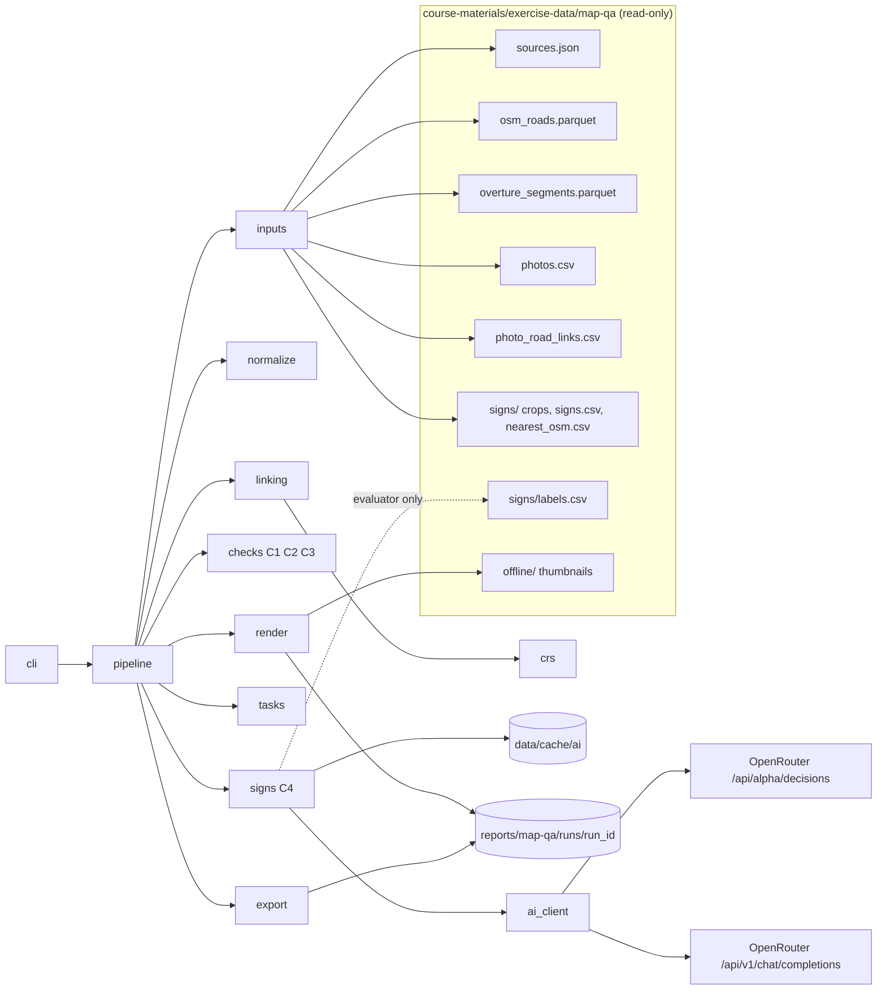
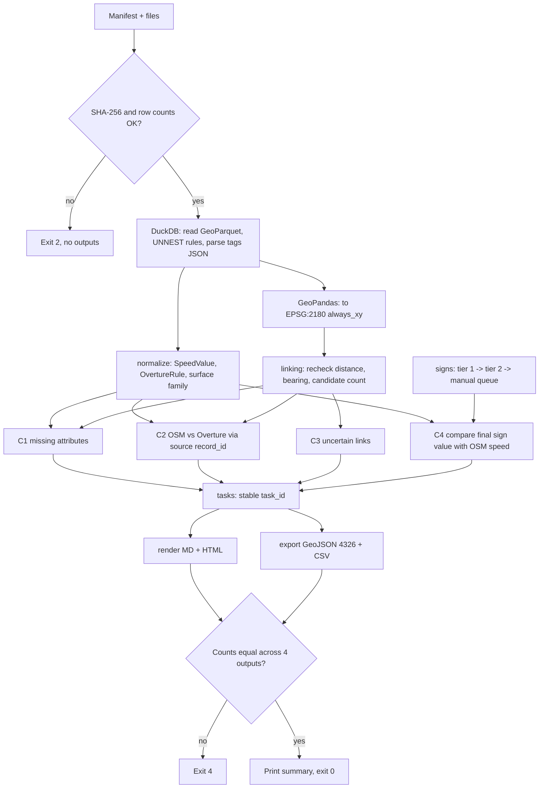
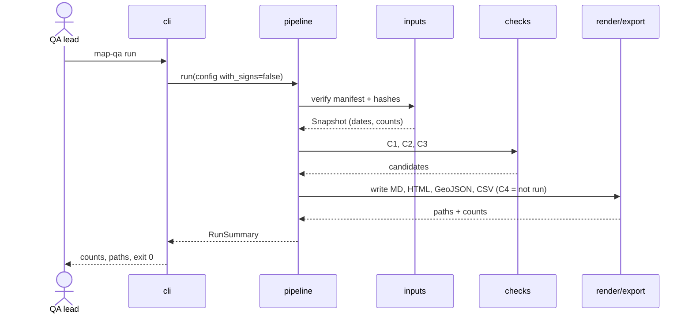
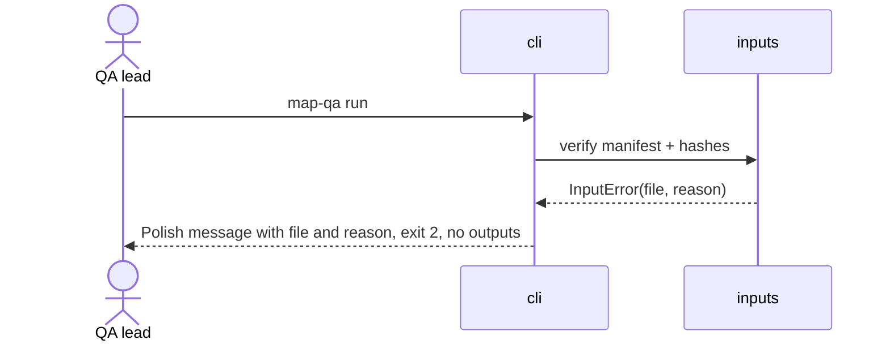

# ADR: Map QA — kontrola atrybutów dróg Krakowa — architektura główna

**Data:** 2026-11-03
**Status:** Accepted
**PRD:** [docs/PRD.md](../PRD.md)

---

## 1. Przegląd

Budujemy narzędzie CLI w Pythonie 3.12. Narzędzie czyta lokalny snapshot danych mapowych Krakowa i wykonuje cztery kontrole:

- **C1:** brakujące atrybuty,
- **C2:** rozbieżności między OSM a Overture,
- **C3:** niepewne dopasowania zdjęcia do drogi,
- **C4:** odczyt wartości ze znaku B-33 przez AI, z eskalacją model decyzyjny → ogólny LLM → kolejka ręczna.

Wynik zapisuje do raportu Markdown, statycznego raportu HTML oraz eksportów GeoJSON i CSV.

Ten ADR i ADR 001–004 przekładają wymagania PRD na decyzje techniczne. Każde AC-xx z PRD ma tu właściciela (moduł) i strategię testu. PRD określa, *co* ma działać. ADR określa, *jak*, i jest wiążący dla agenta implementującego.

ADR-y:

| Plik | Obszar |
|---|---|
| `000-main-architecture.md` | Architektura, stos, moduły, zmienne środowiskowe, strategia testów całości |
| [`001-data-ingest-normalization.md`](001-data-ingest-normalization.md) | Wejścia, manifest, normalizacja `maxspeed`/`speed_limits`/nawierzchni, C1, C2 |
| [`002-crs-photo-road-linking.md`](002-crs-photo-road-linking.md) | CRS, EPSG:2180, kontrola dopasowań zdjęcie–droga, C3 |
| [`003-ai-sign-reading.md`](003-ai-sign-reading.md) | Kontrakt modeli, eskalacja, budżet, cache, C4 |
| [`004-report-export.md`](004-report-export.md) | Raport Markdown/HTML, GeoJSON, CSV, atrybucje |

**Warunki wstępne:**
- Profil danych (krok M2) jest w [`reports/map-qa/profile.md`](../../reports/map-qa/profile.md) (2026-11-12). Punkty, które ADR oznaczał jako „do potwierdzenia w profilu”, rozstrzygnięto w ADR-001–003 (aktualizacja 2026-11-12). Tabela rozstrzygnięć jest w §6 profilu.
- `uv` instalujemy przez `winget install --id astral-sh.uv -e` (0.13.7). Po instalacji trzeba uruchomić nową powłokę, bo zmienia się PATH.
- Na Windows przy przekierowaniu wyjścia Pythona do pliku ustawiamy `PYTHONUTF8=1`. Bez tego tabele DuckDB dają `UnicodeEncodeError` w cp1250.

---

## 2. Odnośniki do dokumentacji technologii

Wersje i identyfikatory sprawdzono 2026-11-03 (PyPI JSON, Context7 CLI, strony dokumentacji).

| Biblioteka | Context7 ID lub oficjalna dokumentacja | Wersja (pin) | Zastosowanie |
|---|---|---|---|
| Python | https://docs.python.org/3.12/ | 3.12 | Środowisko uruchomieniowe |
| uv | https://docs.astral.sh/uv/ | najnowsza | Środowisko, zależności, `uv.lock` |
| DuckDB (+ spatial) | `/duckdb/duckdb-web`, `/websites/duckdb_current`; https://duckdb.org/docs/stable/core_extensions/spatial/overview | `duckdb==2.0.0` | Odczyt GeoParquet, rozpakowanie list struktur Overture, JSON tagów OSM |
| GeoPandas | `/geopandas/geopandas`, `/websites/geopandas_en_stable` | `geopandas==1.2.0` | Ramki geometrii, `to_crs`, zapytania przestrzenne, eksport GeoJSON |
| Shapely | `/shapely/shapely` | `shapely==2.2.0` | Odległość punkt–linia, `line_locate_point`, interpolacja |
| pyproj | `/pyproj4/pyproj`, `/websites/pyproj4_github_io_pyproj_stable` | `pyproj==3.8.0` | `Transformer` z `always_xy=True`, `Geod` do azymutu geodezyjnego |
| pyarrow | https://arrow.apache.org/docs/python/ | `pyarrow==23.0.1` | Silnik Parquet dla GeoPandas (pin zgodny z README danych map-qa) |
| httpx | https://www.python-httpx.org/ | `httpx==0.28.1` | Surowe wywołania OpenRouter |
| OpenRouter Decisions API | `/websites/openrouter_ai`; https://openrouter.ai/docs/api/api-reference/alphadecisions/submit-a-decisions-request | alpha | Krok 1 (model decyzyjny) |
| OpenRouter obrazy w Decisions | https://openrouter.ai/docs/guides/community/multimodal-decisions | — | Format obrazu w `state` |
| OpenRouter chat + reasoning + structured outputs | `/websites/openrouter_ai`; https://openrouter.ai/docs/guides/best-practices/reasoning-tokens.md, https://openrouter.ai/docs/guides/features/structured-outputs.md | — | Krok 2 (ogólny LLM) |
| OpenRouter Python SDK (odrzucony) | `/openrouterteam/python-sdk` | `openrouter==1.3.107` | Tylko porównanie, nie używamy |
| Jinja2 | `/pallets/jinja`, `/websites/jinja_palletsprojects_en_stable` | `jinja2==3.1.6` | Szablony raportu HTML i Markdown |
| Typer | https://typer.tiangolo.com/ | `typer==0.27.3` | CLI, potwierdzenie tak/nie |
| pytest | https://docs.pytest.org/ | `pytest==9.2.0` | Testy |
| pytest-httpx | https://colin-b.github.io/pytest_httpx/ | `pytest-httpx==0.36.2` | Mock httpx z zapisanej prawdziwej odpowiedzi |
| pytest-recording | https://github.com/kiwicom/pytest-recording | `pytest-recording==0.14.1` | `--block-network` w testach |
| respx (alternatywa) | `/lundberg/respx` | `respx==0.23.1` | Rezerwowa alternatywa dla pytest-httpx |
| syrupy | https://pypi.org/project/syrupy/ | `syrupy==6.1.1` | Golden files raportów |
| ruff | https://docs.astral.sh/ruff/ | `ruff==0.17.3` | Lint i format |
| Databricks SQL Statement Execution API (poza MVP) | `/websites/databricks_api`; https://docs.databricks.com/aws/en/dev-tools/sql-execution-tutorial | — | Tylko opcjonalna kontrola zgodności liczności, poza pipeline'em |
| Streamlit (poza MVP) | https://docs.streamlit.io | 1.66.1 | Nie używamy, uzasadnienie w D-07 |
| PySide6 (poza MVP) | https://doc.qt.io/qtforpython-6/ | 6.12.0 | Nie używamy, uzasadnienie w D-07 |

**Zasada pinów:** w `pyproject.toml` wersje są przypięte przez `==`, a `uv.lock` jest commitowany. Wersję zmieniamy osobnym commitem, po sprawdzeniu dokumentacji w Context7.

---

## 3. Architektura systemu

### Wzorzec architektury
Jednoprocesowy monolit CLI z potokiem etapów (pipeline). Każdy etap to czysta funkcja: wejście w postaci tabel w pamięci, wyjście w postaci tabel w pamięci. Wejście/wyjście plikowe i sieciowe jest wyłącznie na brzegach: w modułach `inputs`, `ai_client`, `cache` i `render`. Nie ma serwera ani bazy trwałej. DuckDB działa w pamięci procesu.

### Struktura repozytorium
- `app/`: projekt uv.
  - `app/pyproject.toml`, `app/uv.lock`.
  - `app/src/map_qa/`: pakiet aplikacji (moduły w sekcji 4).
  - `app/src/map_qa/templates/`: szablony Jinja2 (`report.html.j2`, `report.md.j2`).
  - `app/src/map_qa/data/surface_families.csv`: wersjonowane mapowanie nawierzchni (ADR-001).
  - `app/tests/unit/`, `app/tests/integration/`, `app/tests/e2e/`, `app/tests/fixtures/` (małe wycinki prawdziwych danych i zapisane odpowiedzi OpenRouter).
- **Wejścia (tylko odczyt):** `course-materials/exercise-data/map-qa/`.
- **Cache odpowiedzi AI:** `course-materials/exercise-data/map-qa/data/cache/ai/`. Katalog `/data/` jest już ignorowany przez `.gitignore` folderu map-qa.
- **Wyniki uruchomień:** `reports/map-qa/runs/<run_id>/`. Do `.gitignore` dopisujemy `reports/map-qa/runs/`. `reports/map-qa/profile.md` (M2) pozostaje śledzony.

### Stos technologiczny

| Warstwa | Technologia | Uzasadnienie |
|---|---|---|
| Runtime | Python 3.12 + uv | Wymóg kursu, powtarzalne środowisko przez `uv.lock` |
| Odczyt i struktury | DuckDB 2.0 (in-process) | Natywny GeoParquet, `UNNEST` list struktur Overture, `json_extract` tagów OSM |
| Geometria i CRS | GeoPandas + Shapely + pyproj | Jawne `always_xy`, łatwe testy jednostkowe, sprawdzony eksport GeoJSON |
| AI krok 1 | `openai/gpt-6-luna-decisions` przez OpenRouter Decisions | Pytanie `choice` zwraca mapę `probabilities` pod próg 0,7 |
| AI krok 2 | `anthropic/claude-haiku-5.5` przez OpenRouter chat completions, `reasoning.effort = medium` | Inna rodzina niż krok 1, najtańszy kandydat z obrazem, rozumowaniem i JSON schema |
| Klient HTTP | httpx, surowy POST | Jawny timeout, zero ponowień, prosty mock |
| Raport | Jinja2 + autoescape | Bezpieczne escapowanie danych źródłowych |
| CLI | Typer | Opcje z typami, potwierdzenie, ścieżka nieinteraktywna `--yes` do testów |
| Testy | pytest, pytest-httpx, pytest-recording, syrupy | TDD, mock tylko z zapisu, blokada sieci, golden files |

---

## 4. Struktura modułów i zależności

Kierunek zależności jest jeden: `cli` → `pipeline` → (moduły domenowe) → (`model`). Moduły domenowe nie importują `cli` ani `render`. Nie ma zależności cyklicznych.

| Moduł | Odpowiedzialność | Zależy od | Używany przez |
|---|---|---|---|
| `model` | Typy danych (sekcja 5), kody przyczyn, enumy statusów | — | wszystkie |
| `config` | Parametry uruchomienia (ścieżki, próg, limit, flagi), walidacja zakresów | `model` | `cli`, `pipeline` |
| `inputs` | Weryfikacja manifestu i hashy, odczyt plików przez DuckDB/GeoPandas | `model` | `pipeline` |
| `normalize` | Normalizacja `maxspeed`, reguł Overture i nawierzchni (ADR-001) | `model` | `checks` |
| `crs` | Transformatory 4326/CRS84 → 2180 i 2180 → 4326, azymut geodezyjny (ADR-002) | `model` | `linking`, `export` |
| `linking` | Kontrola dopasowań zdjęcie–droga, flagi niepewności (ADR-002) | `crs`, `model` | `checks` |
| `checks` | C1, C2, C3, porównanie znaku z mapą w C4 | `normalize`, `linking`, `model` | `pipeline` |
| `ai_client` | Wywołania HTTP krok 1 i krok 2, licznik żądań, timeout (ADR-003) | `model` | `signs` |
| `cache` | Cache odpowiedzi AI po hashu (ADR-003) | `model` | `signs` |
| `signs` | Orkiestracja eskalacji C4, kolejka ręczna, ewaluacja (ADR-003) | `ai_client`, `cache`, `checks`, `model` | `pipeline` |
| `tasks` | Budowa zadań z kandydatów, stabilne `task_id` (ADR-004) | `model` | `pipeline` |
| `render` | Markdown i HTML przez Jinja2, kopiowanie miniatur (ADR-004) | `model` | `pipeline` |
| `export` | GeoJSON (RFC 7946) i CSV (ADR-004) | `crs`, `model` | `pipeline` |
| `pipeline` | Kolejność etapów, zbieranie liczników, kontrola spójności liczników | moduły domenowe | `cli` |
| `cli` | Komenda `map-qa run`, potwierdzenie C4, kody wyjścia | `config`, `pipeline` | punkt wejścia |

---

## 5. Modele danych

Opis koncepcyjny. Typy implementujemy jako dataclasses lub tabele pandas. Wszystkie modele żyją w pamięci przez jedno uruchomienie, chyba że zaznaczono inaczej.

- **Snapshot:** ścieżka wejść; `osm_extract_date`, `overture_release`, `created_at` z `sources.json`; lista plików z oczekiwanym SHA-256 i rozmiarem; liczności wierszy.
- **OsmRoad:** `osm_id` (int64), `highway`, geometria LineString (4326 i 2180), `tags_raw` (pełny JSON jako tekst, niezmieniony; w pliku to kolumna `tags`), `node_ids`, `boundary_crossing` (bool), `oneway_raw`.
- **SpeedValue (OSM):** `osm_id`, `tag_key` (`maxspeed`, `maxspeed:forward`, `maxspeed:backward`, `maxspeed:conditional` itd.), `raw` (tekst), `value_kmh` (float lub brak), `status` (`numeric` | `not_numeric` | `conditional`), `reason` (`zone`, `none`, `signals`, `multi_value`, `unparsable`, `conditional`), `direction` (`both` | `forward` | `backward`).
- **OvertureRule:** `segment_id` (GERS `id`), `rule_kind` (`speed` | `surface`), `rule_index` (pozycja na liście), `raw_json` (pełna reguła), `value_kmh` lub `surface_raw`, `unit_raw`, `when_raw` (JSON lub brak), `heading` (z `when`, jeśli jest), `between_start`, `between_end`, `whole_segment` (bool), `unconditional` (bool).
- **OvertureSource:** `segment_id`, `source_index`, `dataset`, `record_id` (np. `w123@4`), `osm_way_id` (int, wyprowadzony z `record_id`, jeśli zaczyna się od `w`), `source_between_start`, `source_between_end`, `source_whole_segment` (bool; ADR-001 §3.3).
- **PhotoLink:** wiersz `photo_road_links.csv` (`photo_id`, `osm_way_id`, `overture_id`, `distance_m`, `way_bearing`, `bearing_diff`, `directed_bearing_diff`, `overture_distance_m`, `osm_candidate_count`, `match_method`, `candidate_flags` jako lista) plus pola kontroli: `recheck_distance_m`, `recheck_bearing`, `recheck_status` (`ok` | `mismatch` | `not_checked`).
- **Photo:** wiersz `photos.csv`: identyfikator, współrzędne aparatu, `heading` (float lub brak, nigdy 0 zamiast braku), data, autor, licencja, URL źródła, hashe, `is_panorama`, ścieżka miniatury lokalnej lub brak.
- **Candidate:** `check` (`C1`, `C2`, `C3`, `C4`, `C4-manual`), `reason_code`, identyfikatory (`osm_id`, `segment_id`, `photo_id`), wartości surowe i znormalizowane z obu stron, `distance_m`, `uncertain_link` (bool) i flagi, `comparable` (bool) i powód, `resolved_by` (tylko C4).
- **SignReading:** `photo_id`, `crop_sha256`, `tier` (1 | 2), `model_id`, `answer` (liczba km/h | `none` | `unreadable` | `other`), `probability` (0–1), `probabilities` (mapa, krok 1), `request_outcome` (`ok` | `cached` | `http_error` | `timeout` | `invalid_response` | `not_sent`), `cost_usd`, `cache_key`.
- **SignResolution:** `photo_id`, `resolved_by` (`decision_model` | `general_llm` | `human_pending` | `not_run`), `final_value`, `manual_reason` (`below_threshold` | `unreadable` | `model_unavailable` | `budget_exhausted`).
- **Task:** `task_id` (stabilny hash, ADR-004), pola z AC-33, geometria w WGS84.
- **RunSummary:** liczniki per kontrola i kod przyczyny, liczniki C4 per krok, accuracy z licznikiem i mianownikiem, powód zatrzymania płatnej pętli, ścieżki wyników.
- **Trwałość:** tylko `SignReading` jest trwały, w cache (ADR-003), bezterminowo, aż do ręcznego usunięcia. Wyniki uruchomienia zostają w `reports/map-qa/runs/<run_id>/`.

---

## 6. Kontrakty interfejsów

### 6.1 CLI: `map-qa run`
- **Wejście (opcje):**
  - `--input PATH` (domyślnie `course-materials/exercise-data/map-qa`),
  - `--output PATH` (domyślnie `reports/map-qa/runs`),
  - `--with-signs` (flaga, domyślnie wyłączona),
  - `--max-requests INT` (1–25, domyślnie 25; wartość spoza zakresu daje błąd walidacji),
  - `--threshold FLOAT` (0–1, domyślnie 0,7),
  - `--max-cost-usd FLOAT` (domyślnie 0,50; ADR-003),
  - `--sign-sample INT` (ile wycinków z próbki, domyślnie wszystkie nieodczytane do wyczerpania limitu),
  - `--yes` (potwierdza C4 bez pytania; do testów i automatyzacji).
- **Wyjście:**
  - Kod 0: wszystkie cztery pliki zapisane. Również wtedy, gdy płatna pętla została zatrzymana zgodnie z AC-24 (to stan danych, nie błąd).
  - Kod 2: błąd walidacji wejść lub manifestu (AC-01).
  - Kod 3: błąd zapisu wyników.
  - Kod 4: niezgodność liczników między wynikami (TAC-05).
- **Potwierdzenie C4:** CLI pokazuje plan i pyta „tak/nie” po polsku. Każda odpowiedź inna niż jawne „t”/„tak” oznacza uruchomienie bez C4 (AC-20). Przy `--yes` nie pyta.
- **Konsola:** nigdy nie wypisuje wartości `OPENROUTER_API_KEY` ani nagłówków `Authorization`.

### 6.2 Granice zewnętrzne
- Krok 1 i krok 2: ADR-003, sekcja 5.
- Pliki wejściowe: ADR-001, sekcja 5.
- Pliki wynikowe: ADR-004, sekcja 5.

---

## 7. Zmienne środowiskowe

| Zmienna | Cel | Wymagana | Przykładowa wartość |
|---|---|---|---|
| `OPENROUTER_API_KEY` | Uwierzytelnienie OpenRouter, kroki 1 i 2. Kod sprawdza tylko obecność i nigdy nie loguje wartości | Tylko dla `--with-signs` | `sk-or-…` (nie wpisywać do plików) |
| `MAP_QA_CACHE_DIR` | Nadpisanie katalogu cache AI | Nie | `course-materials/exercise-data/map-qa/data/cache/ai` |

Databricks (`DATABRICKS_HOST`, `DATABRICKS_TOKEN`, identyfikator warehouse) nie jest używany przez MVP.

---

## 8. Decyzje techniczne

### D-01: Hybryda DuckDB + GeoPandas
**Status:** Accepted
**Data:** 2026-11-03
**Context:**
- Overture przechowuje `speed_limits`, `road_surface` i `sources` jako typowane listy struktur z `when` i `between`, a OSM trzyma tagi jako tekst JSON. Obie rzeczy wymagają rozpakowania.
- Obliczenia metryczne wymagają EPSG:2180 i jednoznacznej kolejności osi.

**Decision:**
- DuckDB czyta GeoParquet i CSV oraz rozpakowuje struktury i JSON (`UNNEST`, dostęp do pól, `json_extract`). Do Pythona oddaje płaskie tabele z geometrią WKB.
- GeoPandas/Shapely/pyproj wykonuje transformację do 2180 (`always_xy=True`), zapytania w promieniu, azymut i eksport GeoJSON.
- DuckDB nie wykonuje `ST_Transform` w pipeline'ie.

**Rejected alternatives:**
- Tylko DuckDB spatial: `ST_Transform` dla EPSG:4326 domyślnie przyjmuje kolejność lat/lon i wymaga `always_xy := true`. Typowanie CRS w GEOMETRY dokumentacja opisuje jako eksperymentalne. Nie ma operatora najbliższych-k, a obsługa CRS w eksporcie GeoJSON przez GDAL jest niezweryfikowana.
- Tylko GeoPandas: rozpakowywanie list struktur w pandas jest niewygodne i łatwo w nim zgubić drugą i kolejne reguły (AC-05).

**Consequences:**
- (+) Mniejsze ryzyko zamiany osi.
- (+) Struktury Overture są rozpakowane deklaratywnie i w całości.
- (+) Funkcje geometryczne łatwo testować jednostkowo.
- (-) Dwie biblioteki i konwersja WKB między nimi.

**Review trigger:** zmiana przy wzroście wejścia ponad 2 mln segmentów albo gdy DuckDB oznaczy typowanie CRS jako stabilne.

### D-02: Tylko lokalny snapshot GeoParquet/CSV
**Status:** Accepted
**Data:** 2026-11-03
**Context:**
- PRD wyklucza Databricks i API na żywo.
- Tabele `workspace.map_qa` mają te same dane, ale z geometrią jako BINARY WKB.
- SQL Statement Execution API wymaga tokenu, identyfikatora warehouse i obsługi asynchronicznej (`wait_timeout` 5–50 s, `INLINE` do 25 MiB, `EXTERNAL_LINKS` powyżej).

**Decision:** Pipeline czyta wyłącznie pliki z `course-materials/exercise-data/map-qa/` po weryfikacji hashy z `sources.json`.

**Rejected alternatives:**
- Databricks SQL API / CLI (`databricks api post /api/2.0/sql/statements/`): sekrety, opóźnienie startu warehouse i brak pracy offline w testach. Dopuszczalne wyłącznie jako ręczna kontrola zgodności liczności poza pipeline'em.
- Databricks managed MCP: opcja eksploracyjna dla agenta, nie źródło danych aplikacji.

**Consequences:**
- (+) Pełna powtarzalność.
- (+) Testy działają offline i bez sekretów.
- (-) Brak świeżych danych (zgodnie z PRD).

**Weryfikacja 2026-11-12:** ręczna kontrola zgodności liczności `workspace.map_qa` z plikami lokalnymi daje 8/8 zgodnych miar ([profil §8](../../reports/map-qa/profile.md)). Na Windows w Git Bash wywołanie `databricks api post /api/2.0/...` wymaga `MSYS_NO_PATHCONV=1`.

**Review trigger:** PRD dodaje odświeżanie danych albo nowe obszary.

### D-03: Krok 1 to `openai/gpt-6-luna-decisions`
**Status:** Accepted
**Data:** 2026-11-03
**Context:**
- Potrzebujemy zamkniętego zbioru odpowiedzi z prawdopodobieństwami.
- Strony cenowe Luny i Jev zwracały 404 w dniu badania, a żaden z tych modeli nie jest na publicznej liście `/api/v1/models`.

**Decision:**
- Luna Decisions z pytaniem typu `choice` (ADR-003).
- Cena i opóźnienie zostaną zmierzone na pierwszym wywołaniu (`usage.cost`) i dopisane do ADR-003.

**Rejected alternatives:**
- `typesafe/jev-1.14`: obraz musi mieć co najmniej 256 px na bok (wycinki trzeba by powiększać), a według dokumentacji tryb obrazowy działa wolniej i mniej dokładnie.
- Porównanie obu: zużywa budżet jednego uruchomienia. Do ponownej decyzji po pierwszych wynikach.

**Consequences:**
- (+) Mapa `probabilities` bezpośrednio pod próg.
- (-) Niezweryfikowana cena i model w wersji alpha.

**Review trigger:** accuracy kroku 1 poniżej 60% na ocenionych wycinkach albo koszt powyżej 0,02 USD na żądanie.

### D-04: Krok 2 to `anthropic/claude-haiku-5.5`, reasoning medium
**Status:** Accepted
**Data:** 2026-11-03
**Context:** PRD wymaga ogólnego multimodalnego LLM ze średnim poziomem rozumowania. Otwarte pytanie z PRD dotyczyło tego, czy ma to być inna rodzina modeli niż w kroku 1.

**Decision:**
- Haiku 5.5 przez chat completions OpenRouter, `reasoning.effort = "medium"`, `response_format` z `json_schema` w trybie strict, `provider.require_parameters = true`.
- Inna rodzina niż OpenAI zmniejsza ryzyko skorelowanych błędów obu kroków.

**Rejected alternatives:**
- `google/gemini-3.8-flash`: wyższa cena, zależna od dostawcy (0,375–0,825 USD wejście / 1,875–4,125 USD wyjście za mln tokenów).
- `x-ai/grok-4.7`: około 20× droższy na wejściu.

**Consequences:**
- (+) Niski koszt: 0,10 / 0,50 USD za mln tokenów.
- (-) Pewność jest deklarowana przez model, a nie skalibrowana. Mierzymy ją osobnym accuracy kroku 2 (AC-28).

**Review trigger:** accuracy kroku 2 niższe niż kroku 1 na tych samych typach przypadków.

### D-05: Surowy POST przez httpx zamiast SDK OpenRouter
**Status:** Accepted
**Data:** 2026-11-03
**Context:**
- SDK `openrouter` 1.3.107 ma domyślnie WŁĄCZONE ponowienia (backoff), co łamie AC-24 i limit 25 żądań.
- Ścieżka bazowa SDK (`/api/v1`) nie zgadza się jednoznacznie z endpointem `/api/alpha/decisions`.
- Natywny klient OpenAI jest wykluczony przez wymagania.

**Decision:** Jeden `httpx.Client` bez warstwy ponowień, z jawnym limitem czasu (ADR-003). Ciała żądań budujemy zgodnie z dokumentacją API.

**Rejected alternatives:**
- SDK z `RetryConfig("none")`: typowane błędy, ale wersja alpha i ryzyko, że aktualizacja przywróci ponowienia bez naszej wiedzy.
- Natywny klient OpenAI: wykluczony.

**Consequences:**
- (+) Pełna kontrola liczby prób.
- (+) Mock przez pytest-httpx.
- (-) Kontrakt odpowiedzi utrzymujemy sami.

**Review trigger:** Decisions API wychodzi z alpha, a SDK ma stabilny wyłącznik ponowień.

### D-06: Dopasowania z pliku plus niezależna kontrola
**Status:** Accepted
**Data:** 2026-11-03
**Context:** `photo_road_links.csv` zawiera kandydatów z regułą opisaną w `sources.json`. Nie jest to prawda terenowa.

**Decision:**
- Używamy kandydatów i flag z pliku.
- Pipeline niezależnie przelicza dystans w EPSG:2180, lokalny azymut drogi i liczbę dróg OSM w 25 m. Niezgodność z plikiem powyżej tolerancji dodaje flagę `link_recheck_mismatch`, a link staje się niepewny (ADR-002).

**Rejected alternatives:**
- Tylko plik: brak wykrycia błędów w danych pomocniczych.
- Własne pełne dopasowanie: duplikuje gotową regułę i wydłuża MVP.

**Consequences:**
- (+) Wykrywamy rozjazd CRS i błędy w danych pomocniczych.
- (-) Dodatkowy kod geometrii.

**Review trigger:** liczba `link_recheck_mismatch` powyżej 5% linków (wtedy przechodzimy na własne dopasowanie).

### D-07: Statyczny raport Jinja2, bez dashboardu
**Status:** Accepted
**Data:** 2026-11-03
**Context:** PRD wyklucza interaktywny dashboard. HTML ma się otwierać z dysku i escapować dane źródłowe.

**Decision:**
- Jinja2 3.1.6, `PackageLoader`, `select_autoescape` dla `.html`, `StrictUndefined`.
- Osobne środowisko bez autoescape dla Markdown, z jawnym escapowaniem znaków Markdown (ADR-004).

**Rejected alternatives:**
- Czysty Python z `html.escape`: każde pominięte wywołanie to luka XSS.
- Streamlit 1.66.1: wymaga działającego serwera (`streamlit run`), co przeczy AC-31.
- PySide6 6.12.0: aplikacja desktopowa z ciężkim pakowaniem (`pyside6-deploy`, Nuitka) zamiast pliku raportu.

**Consequences:**
- (+) Escapowanie domyślne.
- (+) Brakujące zmienne zatrzymują renderowanie zamiast cicho znikać.
- (-) Jedna dodatkowa zależność.

**Review trigger:** PRD dodaje dashboard.

### D-08: Typer jako CLI
**Status:** Accepted
**Data:** 2026-11-03
**Context:** CLI potrzebuje kilku opcji z walidacją i potwierdzenia tak/nie. PRD wymaga, by brak jawnego „tak” uruchamiał narzędzie bez C4, zamiast przerywać działanie.

**Decision:**
- Typer 0.27.3.
- Potwierdzenie bez `abort=True`: odpowiedź negatywna wyłącza C4 i pipeline idzie dalej.
- Flaga `--yes` daje ścieżkę nieinteraktywną.

**Rejected alternatives:**
- argparse: brak promptu, trzeba pisać obsługę `input()` ręcznie.
- Click bezpośrednio: więcej kodu bez korzyści dla tak małego CLI.

**Consequences:**
- (+) Polskie opisy pomocy, typy opcji.
- (-) Zależność.

**Review trigger:** wymóg zera zależności.

### D-09: Języki
**Status:** Accepted
**Data:** 2026-11-03
**Decision:**
- ADR po polsku (decyzja użytkownika).
- Teksty raportu i konsoli dla użytkownika po polsku (AC-38).
- Identyfikatory, nazwy plików, kody przyczyn i pola eksportu po angielsku.
- Pytanie do modelu po angielsku. Ustalone w ADR-003, nie jest widoczne dla użytkownika.

---

## 9. Diagramy

### 9.1 Diagram komponentów

### 9.2 Przepływ danych

### 9.3 Diagramy sekwencji

#### Uruchomienie bez C4 (ścieżka podstawowa)

#### Błędne wejście

#### Uruchomienie z C4: patrz ADR-003, sekcja 7.

---

## 10. Strategia testów

### Filozofia
- **TDD na każdym etapie:** najpierw test z wymagania (AC z PRD albo TAC z ADR), uruchomienie i potwierdzenie czerwonego wyniku z oczekiwanego powodu, minimum kodu do zielonego, refaktor przy zielonych testach.
- **Uczciwe testy:** testów nie osłabiamy pod implementację.
- **Fixture'y z prawdziwych danych:** małe, prawdziwe wycinki wejść, skopiowane do `app/tests/fixtures/` z adnotacją źródła (plik, identyfikatory, hash źródła). Nie zmyślamy kształtów danych.
- **Mocki API z zapisu:** mock API wyłącznie z zapisanej prawdziwej odpowiedzi (ADR-003, sekcja 8). Bez zapisu testu integracyjnego AI nie piszemy. Zgłaszamy brakujący warunek.
- **Blokada sieci:** `pytest-recording --block-network` w `addopts`. Żaden test nie dotyka prawdziwej sieci.
- **Rzeczywiste uruchomienie na koniec etapu:** każdy etap kończy się uruchomieniem prawdziwego CLI (`uv run map-qa run …`) na pełnym snapshocie. Jeden wynik sprawdzamy ręcznie, od wejścia do wiersza raportu. W podsumowaniu etapu osobno raportujemy: instalację/kompilację, testy (liczba wykrytych, przeszłych, pominiętych) i uruchomienie CLI.

### Warstwy testów

| Warstwa | Typ | Zakres | Narzędzia |
|---|---|---|---|
| Unit | Czyste funkcje | Parser `maxspeed`, reguły Overture, rodziny nawierzchni, CRS, azymut, eskalacja, `task_id`, escapowanie | pytest |
| Integration | Moduł z I/O | Odczyt DuckDB na fixture'ach GeoParquet, cache na dysku (tmp), `ai_client` z pytest-httpx i zapisanymi odpowiedziami, render z syrupy | pytest, pytest-httpx, syrupy |
| E2E | Prawdziwe CLI, bez mocków | `map-qa run` bez C4 na pełnym snapshocie; z C4 tylko na cache (zero nowych żądań) | pytest + subprocess, ręczna kontrola HTML |

### Kluczowe scenariusze (całość; szczegóły w ADR 001–004)
- **Manifest:** zgodne hashe dają start. Zmieniony bajt w kopii pliku daje kod 2 i brak wyników (AC-01).
- **Wejścia nietknięte:** hashe wszystkich wejść przed i po E2E są identyczne (AC-02).
- **Liczności:** nagłówek raportu pokazuje 99 768 / 85 405 / 561 dla dostarczonego snapshotu (AC-03).
- **Spójność liczników:** te same liczby kandydatów w MD, HTML, GeoJSON i CSV (AC-30).
- **Powtarzalność:** dwa uruchomienia z tym samym cache dają identyczne bajtowo GeoJSON i CSV (AC-35).
- **Brak klucza z `--with-signs`:** zero żądań, C1–C3 zapisane, komunikat o braku klucza bez wartości (AC-37).

### Techniczne kryteria akceptacji
- **TAC-01:** `uv sync --frozen` i `uv run pytest` przechodzą na czystym klonie. Raport testów pokazuje liczbę testów wykrytych, zaliczonych i pominiętych, a pominięcia mają podany powód.
- **TAC-02:** `uv run ruff check` i `uv run ruff format --check` nie zgłaszają błędów w `app/`.
- **TAC-03:** Żaden test nie otwiera połączenia sieciowego (wymusza to `--block-network`).
- **TAC-04:** `map-qa run` bez C4 na pełnym snapshocie kończy się kodem 0 w czasie poniżej 120 s na VM kursowej.
- **TAC-05:** Pipeline przed zakończeniem porównuje liczby kandydatów per kontrola w czterech wynikach. Przy niezgodności kończy się kodem 4.
- **TAC-06:** `grep` po katalogu wyników i logach nie znajduje fragmentu wartości `OPENROUTER_API_KEY` (test z fałszywym kluczem testowym w zmiennej środowiskowej).
- **TAC-07:** Każdy etap planu kończy się zapisanym dowodem rzeczywistego uruchomienia CLI (polecenie, kod wyjścia, liczniki) w podsumowaniu etapu.
