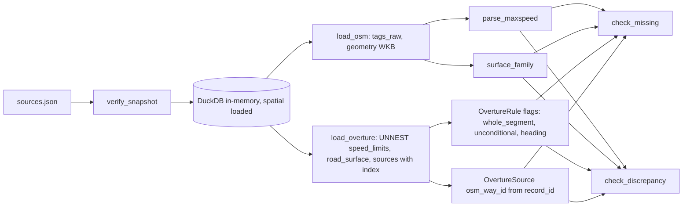
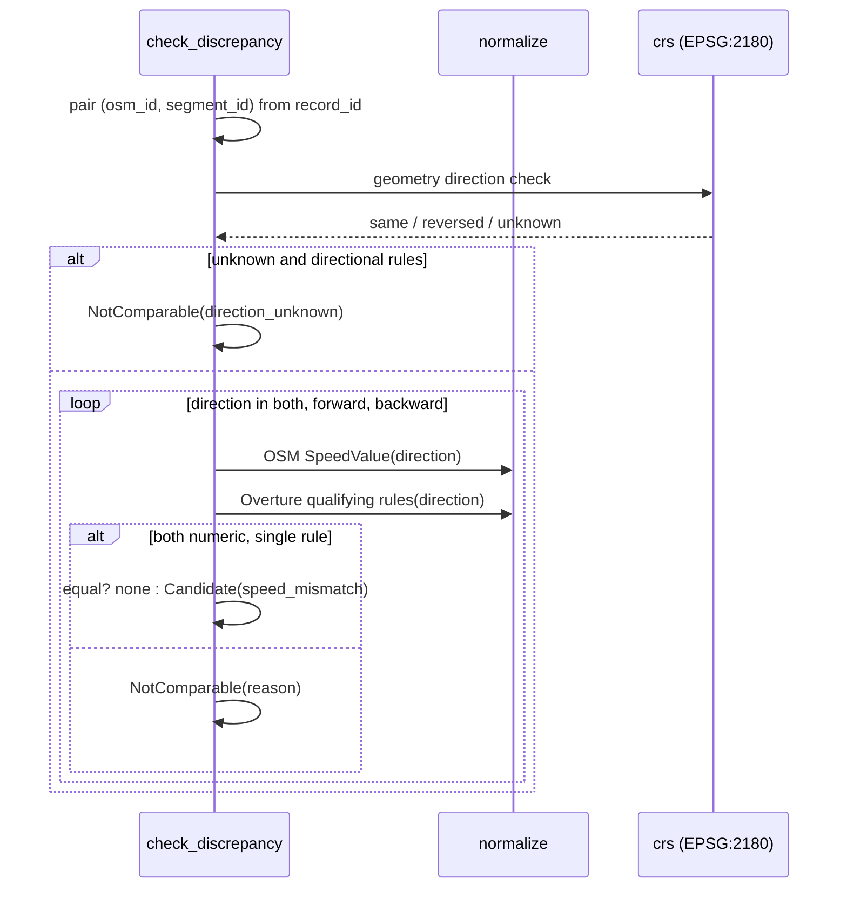

# ADR-001: Wejścia, normalizacja atrybutów, C1 i C2

**Data:** 2026-11-03
**Aktualizacja:** 2026-11-12, ustalenia z profilu M2 ([`reports/map-qa/profile.md`](../../reports/map-qa/profile.md)): `road_surface` bez `when`, mapowanie nawierzchni Overture, kod `partial_source`, nazwa kolumny `tags`
**Status:** Accepted
**Relates to:** [`000-main-architecture.md`](000-main-architecture.md)

---

## 1. Zakres

**Obejmuje:**
- weryfikację snapshotu (AC-01–AC-03),
- odczyt plików przez DuckDB,
- normalizację OSM `maxspeed*`, `surface`, `lanes`, `lit` (AC-04, AC-06, AC-07),
- normalizację Overture `speed_limits`, `road_surface` i `sources` (AC-05),
- kontrolę C1 (AC-08–AC-10),
- kontrolę C2 (AC-11–AC-15).

**Nie obejmuje:**
- CRS i dopasowań zdjęć (ADR-002),
- odczytu znaków (ADR-003),
- formatu wyników (ADR-004).

---

## 2. Odnośniki do dokumentacji

| Biblioteka | Context7 ID lub dokumentacja | Zastosowanie |
|---|---|---|
| DuckDB 2.0.0 | `/duckdb/duckdb-web`; https://duckdb.org/docs/stable/core_extensions/spatial/overview | Odczyt Parquet z automatyczną konwersją kolumn geometrii, `UNNEST`, dostęp do struktur, funkcje JSON |
| GeoPandas 1.2.0 | `/geopandas/geopandas` | Ramki z geometrią po odczycie (WKB → Shapely) |
| Schemat Overture transportation/segment | https://docs.overturemaps.org/schema/reference/transportation/segment/ | Nazwy pól reguł (potwierdzone w profilu M2, §3) |
| OSM `maxspeed` | https://wiki.openstreetmap.org/wiki/Key:maxspeed | Format wartości, jednostki, kody stref |
| OSM `surface` | https://wiki.openstreetmap.org/wiki/Key:surface | Wartości nawierzchni |

---

## 3. Projekt komponentów

### 3.1 `inputs`
1. Czyta `sources.json` i wybiera z sekcji `files` listę wymaganych plików z oczekiwanym `sha256` i `bytes`.
2. Dla każdego pliku liczy SHA-256 strumieniowo, w blokach po 1 MiB.
   - Pierwszy brakujący plik albo niezgodny hash przerywa pracę błędem `InputError(file, reason)`, z kodem przyczyny `missing`, `hash_mismatch` lub `unreadable`.
   - Weryfikacja kończy się, zanim powstanie katalog wyników.
3. Wymagane pliki: `osm_roads.parquet`, `overture_segments.parquet`, `photos.csv`, `photo_road_links.csv`, `signs/signs.csv`, `signs/nearest_osm.csv`, `signs/labels.csv`. Pliki `signs/` są wymagane tylko z `--with-signs`. Jeśli nie ma ich w `sources.json`, sprawdzamy tylko, czy istnieją, i raportujemy to jako `hash_not_in_manifest`.
   - Profil M2 potwierdził, że w dostarczonym snapshocie **żaden** plik `signs/` nie ma hasha w `sources.json.files`, więc ścieżka `hash_not_in_manifest` jest zawsze aktywna dla C4. Integralność wycinków zapewnia osobno `crop_sha256` z `signs.csv` (ADR-003 §3.2).
4. Pliki opcjonalne (`signs/photos/`, `signs/crops/`, `offline/`, pobrane zdjęcia w `data/`, `traffic_signs.geojson`) nie przerywają pracy.
   - `traffic_signs.geojson` jest w manifeście, ale **żadna kontrola MVP go nie czyta**. Wartość Mapillary dla C4 pochodzi z `signs/signs.csv` (`mapillary_value`). Gdy plik istnieje, weryfikujemy jego hash (AC-01), a gdy go brakuje, odnotowujemy to w raporcie bez przerywania pracy (zmiana 2026-11-12, review dokumentów). Brak pliku jest odnotowany na poziomie wiersza (PRD, sekcja 4.4).
5. Odczyt idzie przez jedno połączenie DuckDB w pamięci, z załadowanym rozszerzeniem `spatial` (`INSTALL`/`LOAD`, bo nie ładuje się automatycznie). Parquet czytamy zwykłym czytnikiem, który przy załadowanym `spatial` sam zamienia kolumny geometrii na `GEOMETRY`. Do Pythona geometria trafia jako WKB.
6. Liczności wierszy porównujemy z `rows` w `sources.json` (OSM 99 768, Overture 85 405, zdjęcia 561, linki 561). Przy niezgodności zwracamy `InputError(row_count_mismatch)`.
7. Wejścia są otwierane tylko do odczytu. Nic nie jest zapisywane w katalogu wejść poza `data/cache/` (ADR-003).

### 3.2 `normalize`: OSM
- **Surowe tagi:** `tags_raw` (pełny JSON jako tekst) przechodzi bez zmian do modelu `OsmRoad` i do eksportu (AC-04). Nie parsujemy go „w miejscu” i nie serializujemy ponownie.
  - Źródłem jest kolumna **`tags`** (VARCHAR) w `osm_roads.parquet`. Plik ma też gotowe kolumny `maxspeed`, `surface`, `lanes`, `lit`, `oneway` i inne. Profil M2 pokazał, że `maxspeed` = `tags.maxspeed` (0 rozbieżności). Mimo to wszystkie klucze prędkości, także kierunkowe i warunkowe, czytamy z `tags`, żeby mieć jedno źródło prawdy.
  - W dostarczonym snapshocie wszystkie wartości `maxspeed` to liczby całkowite (4–140). **`PL:urban` występuje w 1 `maxspeed:forward` i 4 `maxspeed:backward`**, więc ścieżka `not_numeric / zone` działa na prawdziwych drogach i ma fixture z prawdziwych wierszy. `maxspeed:conditional` ma zawsze postać `110 @ (Mo-Fr 06:00-18:00)`. Ścieżki mph, `none`, `signals` i wartości wielokrotnych pokrywamy testami jednostkowymi na danych syntetycznych (TAC-001-01).
- **Klucze prędkości** (każdy daje osobny `SpeedValue`): `maxspeed`, `maxspeed:forward`, `maxspeed:backward`, `maxspeed:conditional`, `maxspeed:type`, `source:maxspeed`, `zone:maxspeed`. Klucze `*:type`, `source:*` i `zone:*` są tylko kontekstem (bez `value_kmh`).
- **Parser wartości `maxspeed`** (deterministyczny, w kolejności):
  1. Usuń spacje z brzegów. Pusty tekst lub brak tagu daje `missing`, a nie wiersz `SpeedValue`.
  2. Tekst zawiera `;` lub `|`: `not_numeric / multi_value`.
  3. Liczba całkowita lub dziesiętna bez jednostki: `numeric`, wartość w km/h.
  4. Liczba z sufiksem `km/h` albo `kmh`, ze spacją lub bez: `numeric`.
  5. Liczba z sufiksem `mph`: `numeric`, `value_kmh = liczba × 1,609344`, zaokrąglone do 0,1. Oryginał zostaje w `raw`.
  6. Liczba z sufiksem `knots`: `not_numeric / unparsable` (nie dotyczy dróg).
  7. Wzorzec `XX:yyy` (np. `PL:urban`, `PL:rural`, `PL:zone30`): `not_numeric / zone`. Nie wnioskujemy prędkości ustawowej.
  8. `none`: `not_numeric / none`; `signals`: `not_numeric / signals`; `walk`: `not_numeric / zone`.
  9. Każdy inny tekst: `not_numeric / unparsable`.
- **`maxspeed:conditional`:** zawsze `status = conditional`. Nie parsujemy go do liczby, raw zostaje.
- **Kierunek:** `maxspeed` → `both`, `maxspeed:forward` → `forward`, `maxspeed:backward` → `backward`. „Forward” oznacza zgodnie z kolejnością `node_ids`.
- **Atrybuty C1:**
  - `surface`, `lanes`, `lit`: obecność klucza w tagach.
  - Prędkość jest obecna, gdy istnieje którykolwiek z kluczy `maxspeed`, `maxspeed:forward`, `maxspeed:backward` (AC-08).

### 3.3 `normalize`: Overture
Overture rozpakowujemy w DuckDB, zachowując indeks na liście (`rule_index` od 0):

- **`speed_limits`:** jeden `OvertureRule(rule_kind=speed)` na każdy element listy (AC-05). Pola:
  - `max_speed.value` i `max_speed.unit` → `value_kmh`; `mph` przeliczamy jak w OSM, `km/h` bez zmian.
  - `min_speed`, `is_max_speed_variable` zostają w `raw_json`.
  - `when` → `when_raw` (pełny JSON), a `when.heading` → `heading`. Pola `when` w danych: `during`, `heading`, `using`, `recognized`, `mode`, `vehicle`.
  - `between` → `between_start`, `between_end`.
  - Nazwy pól potwierdził profil M2. W danych `max_speed.unit` to zawsze `km/h`, a `min_speed` nie występuje. Przeliczenie mph zostaje jako zabezpieczenie i ma test jednostkowy.
  - W SQL DuckDB pola `when`, `between`, `using`, `mode` i `value` trzeba cytować (`s['when']` lub `"when"`), bo to słowa kluczowe.
- **`road_surface`:** jeden `OvertureRule(rule_kind=surface)` na element. Schemat to `STRUCT(value, between)[]`, **bez `when`**. `value` → `surface_raw`, `between` jak wyżej. Każda reguła nawierzchni jest więc bezwarunkowa (`unconditional = true`, `when_raw` puste).
- **`raw_json`:** pełna struktura elementu jako JSON (serializacja DuckDB `to_json`). Eksport pokazuje ją bez skracania.
- **Flagi reguły:**
  - `whole_segment = true`, gdy `between` jest puste albo równe [0, 1].
  - `unconditional = true`, gdy `when` jest puste. Jeśli `when` zawiera wyłącznie `heading`, reguła jest bezwarunkowa, ale kierunkowa. Każde inne niepuste pole `when` (`mode`, `during`, `using`, `recognized`, `vehicle`) czyni regułę warunkową. Najczęstszy przypadek w danych to `mode: [bus, hgv]` (395 reguł).
  - `is_max_speed_variable = true` → `comparable = false / variable`.
- **`sources`:** jeden `OvertureSource` na element. `osm_way_id` wyprowadzamy z `record_id` według wzorca `w<liczba>@<wersja>`. Inny wzorzec, np. `n…` lub `r…`, nie daje referencji do way. W danych: 106 270 wpisów `w…@…`, 1 854 relacje `r…`, 791 wpisów TomTom bez `record_id` OSM.
  - `sources[].between` → `source_between_start`, `source_between_end`. Pole oznacza część segmentu, której dotyczy dany way. `source_whole_segment = true`, gdy `between` jest puste albo równe [0, 1].

### 3.4 `normalize`: rodziny nawierzchni
- Mapowanie trzymamy w wersjonowanym pliku `app/src/map_qa/data/surface_families.csv` z kolumnami `source` (`osm` | `overture`), `value`, `family` (`paved` | `unpaved` | `unknown`). Raport pokazuje mapowanie w całości (AC-13).
- **Wartości OSM:**
  - `paved`: `paved`, `asphalt`, `chipseal`, `concrete`, `concrete:plates`, `concrete:lanes`, `concrete_slabs`, `concrete:slabs`, `paving_stones`, `paving_stones:lanes`, `sett`, `unhewn_cobblestone`, `cobblestone`, `bricks`, `metal`, `metal_grid`, `wood`.
  - `unpaved`: `unpaved`, `compacted`, `fine_gravel`, `gravel`, `pebblestone`, `rock`, `ground`, `dirt`, `earth`, `mud`, `sand`, `grass`, `woodchips`.
  - `unknown`: `grass_paver` i każda wartość spoza listy.
  - Dopisane po profilu M2: `concrete_slabs`, `concrete:slabs`, `metal_grid` (razem 9 dróg).
  - **Literówek i wartości lokalnych nie poprawiamy.** `contrete:plates`, `conrete:plates`, `ompacted`, `paving_Stones`, `utwardzona`, `kostka_/_płyty_chodnikowex`, `grass/dirt` i `bad` (10 dróg) dostają `unknown`. To dane do poprawy w OSM, nie w mapowaniu. Dopasowanie bez rozróżniania wielkości liter też odrzucamy, bo ukryłoby błędy tagowania.
- **Wartości Overture** (komplet z profilu M2, 7 wartości):
  - `paved`: `paved`, `paving_stones`, `metal`,
  - `unpaved`: `unpaved`, `gravel`, `dirt`,
  - `unknown`: `unknown`.
- Nowa wartość spoza pliku dostaje `unknown`. Raport wypisuje listę takich wartości z licznością.

### 3.5 `checks`: C1
- **OSM:** dla każdego atrybutu (`maxspeed*`, `surface`, `lanes`, `lit`) liczymy drogi bez atrybutu i ich udział, w podziale na `highway`. Mianownik to liczba dróg danej klasy w snapshocie.
- **Overture:** segmenty bez żadnej reguły `speed_limits` i bez żadnej reguły `road_surface`, w podziale na `class`.
- **Zadania C1** powstają tylko dla dróg OSM, które mają co najmniej jeden link w `photo_road_links.csv` (`osm_way_id`) (AC-10). Jedno zadanie to para (droga, brakujący atrybut), a zdjęcia są dołączone jako lista. Segmenty Overture bez reguł są tylko w podsumowaniu.

### 3.6 `checks`: C2
1. **Pary:** dla każdego `OvertureSource` z `osm_way_id` istniejącym w `osm_roads` tworzymy parę (way, segment) z `match_method = osm_source_reference` (AC-11). Segmenty bez takiej referencji nie są porównywane. Ich linki `spatial_fallback` z `photo_road_links.csv` trafiają na listę „tylko przestrzenne”.
   - W danych 84 611 z 85 405 segmentów (99,1%) ma referencję do way. Daje to 106 270 par, w tym 105 809 z way obecnym w snapshocie. Jeden segment bywa zbudowany z kilku way.
   - **Częściowe źródło:** jeśli `source_whole_segment = false` (way dotyczy tylko części segmentu), wszystkie porównania tej pary trafiają do „not comparable / `partial_source`”. Reguła Overture na cały segment nie musi odpowiadać wartości z way, który obejmuje tylko jego fragment. Zgodnie z PRD 4.5 nie wymuszamy porównania.
2. **Prędkość** (AC-12, AC-14), dla każdej pary i każdego kierunku (`both`, `forward`, `backward`):
   - **Strona OSM:**
     - Bierzemy `SpeedValue` dla danego kierunku. `forward`/`backward` dziedziczą `both`, jeśli nie mają własnego tagu.
     - Gdy istnieje `maxspeed:conditional`, porównanie odbywa się nadal na wartości bezwarunkowej, ale kandydat ma flagę `osm_conditional_present`.
   - **Strona Overture:**
     - Reguły `speed`, które mają `whole_segment = true`, `unconditional = true` i zgodny kierunek.
     - Reguła bez `heading` jest typu `both`.
     - Reguła z `heading = forward`/`backward` odpowiada kierunkowi geometrii segmentu Overture.
   - **Zgodność kierunku geometrii:**
     - Porównanie kierunkowe wymaga, by segment Overture i way OSM miały zgodny kierunek geometrii.
     - Sprawdzenie: azymut od pierwszego do ostatniego wierzchołka segmentu w EPSG:2180 porównujemy z azymutem odcinka way OSM, liczonym między punktami tego way najbliższymi końcom segmentu.
     - Różnica ≤ 45° oznacza kierunek zgodny, ≥ 135° przeciwny (wtedy `forward`↔`backward` zamieniamy). Wartość pomiędzy daje `comparable = false / direction_unknown`.
   - **Wynik porównania:**
     - Obie strony `numeric` i różna wartość po zaokrągleniu do 0,1 km/h: kandydat `C2 / speed_mismatch`.
     - Obie wartości równe: brak kandydata.
     - Po którejkolwiek stronie `not_numeric`, reguła warunkowa, częściowa albo niejednoznaczna (więcej niż jedna reguła kwalifikująca się dla tego samego kierunku): wiersz „not comparable” z kodem `not_numeric`, `conditional`, `partial_segment`, `partial_source`, `direction_unknown`, `variable` lub `multiple_rules`.
     - Para „reguła bezwarunkowa + reguła warunkowa” (np. 70 dla wszystkich i 50 dla `mode: [bus, hgv]`) **nie** daje `multiple_rules`, bo kwalifikuje się tylko reguła bezwarunkowa.
     - Brak wartości po jednej stronie to sprawa C1, nie C2.
3. **Nawierzchnia** (AC-13): OSM `surface` z jednej strony. Z drugiej Overture `road_surface` z `whole_segment` (reguły nawierzchni zawsze są bezwarunkowe, punkt 3.3). Kandydat `C2 / surface_family_mismatch` powstaje, gdy obie rodziny są znane i różne. `unknown` po którejkolwiek stronie daje „not comparable / unknown_family”. Reguły z `between` dają `partial_segment`, a częściowe źródło daje `partial_source`.
4. **Pola kandydata** (AC-15): obie wartości surowe, obie znormalizowane, `osm_id`, `segment_id`, `rule_index`, `osm_extract_date`, `overture_release`.

---

## 4. Struktury danych

Opisane w ADR-000, sekcja 5: `Snapshot`, `OsmRoad`, `SpeedValue`, `OvertureRule`, `OvertureSource`, `Candidate`.

Dodatkowo `NotComparable`: `check`, `osm_id`, `segment_id`, `rule_index`, `direction`, `reason_code`, `osm_raw`, `overture_raw`.

---

## 5. Kontrakty interfejsów

- `verify_snapshot(input_dir, with_signs) → Snapshot | InputError`.
- `load_osm(snapshot) → tabela OsmRoad` (geometria WKB 4326, `tags_raw`).
- `load_overture(snapshot) → (tabela segmentów, tabela OvertureRule, tabela OvertureSource)`.
- `parse_maxspeed(raw) → (status, value_kmh | None, reason | None)`. To czysta funkcja.
- `surface_family(source, value) → paved | unpaved | unknown`. To czysta funkcja.
- `check_missing(osm, overture, links) → (podsumowanie C1, kandydaci C1)`.
- `check_discrepancy(osm, overture_rules, sources, links) → (kandydaci C2, lista not comparable, lista spatial-only)`.

**Błędy:** `InputError` z kodem i nazwą pliku. Pozostałe funkcje nie rzucają na danych. Wartość nieznana daje status, nie wyjątek.

---

## 6. Decyzje techniczne

### D-101: Parser `maxspeed` jako czysta funkcja z zamkniętą listą kodów
**Status:** Accepted
**Data:** 2026-11-03
**Context:** Wartości OSM obejmują liczby, jednostki, strefy, wartości wielokrotne i teksty swobodne. PRD zabrania wymuszania porównania.
**Decision:**
- Deterministyczny parser z kolejnością reguł z punktu 3.2.
- Kody przyczyn: `zone`, `none`, `signals`, `multi_value`, `unparsable`, `conditional`.
- Tekst surowy zawsze zostaje.

**Rejected alternatives:**
- Mapowanie stref na prędkości ustawowe: wymaga decyzji prawnej, PRD je wyklucza.
- Regex wyciągający pierwszą liczbę: zamienia `50;70` w 50.

**Consequences:**
- (+) Pełna śledzalność.
- (-) Wartości strefowe nie są porównywane.

**Review trigger:** PRD dodaje mapowanie stref.

### D-102: Jedna reguła Overture to jeden rekord
**Status:** Accepted
**Data:** 2026-11-03
**Context:** AC-05 wymaga zachowania wszystkich reguł z `when`/`between`.
**Decision:** `UNNEST` z indeksem pozycji w DuckDB i pełny element jako `raw_json`. Do porównania kwalifikują się tylko reguły bezwarunkowe, na cały segment, w zgodnym kierunku.

**Rejected alternatives:**
- Pierwszy element listy: gubi kolejne reguły.
- Spłaszczenie do kolumn: gubi nieznane pola.

**Consequences:**
- (+) Brak utraty informacji.
- (-) Więcej wierszy „not comparable”.

**Review trigger:** zmiana schematu Overture w nowym wydaniu. Profil M2 z 2026-11-12 potwierdził nazwy pól dla wydania 2026-10-21.0.

### D-103: Porównanie tylko przez referencję źródła
**Status:** Accepted
**Data:** 2026-11-03
**Context:** AC-11. Dopasowanie przestrzenne może połączyć różne jezdnie.
**Decision:** Pary powstają wyłącznie z `sources[].record_id` → OSM way.

**Rejected alternatives:**
- Najbliższy segment w promieniu: fałszywe rozbieżności na równoległych jezdniach.

**Consequences:**
- (+) Mniej fałszywych alarmów.
- (-) Segmenty bez referencji są poza C2.

**Review trigger:** udział segmentów bez referencji OSM powyżej 20% w profilu. Profil M2 z 2026-11-12 pokazał 0,9%.

### D-104: Kontrola kierunku geometrii przed porównaniem kierunkowym
**Status:** Accepted
**Data:** 2026-11-03
**Context:** Segment Overture może mieć geometrię odwróconą względem OSM way albo być jego częścią.
**Decision:** Porównanie azymutów w EPSG:2180 z progami 45° i 135°. Strefa pośrednia daje `direction_unknown`.

**Rejected alternatives:**
- Założenie zgodnego kierunku: błędne `forward`/`backward`.

**Consequences:**
- (+) Brak błędnych par kierunkowych.
- (-) Pętle i krzywe mogą trafić do `direction_unknown`.

**Review trigger:** więcej niż 10% par kierunkowych z `direction_unknown`.

---

## 7. Diagramy

### Komponenty

### Sekwencja C2 dla jednej pary

---

## 8. Strategia testów

### Scenariusze

| Scenariusz | Typ | Wejście | Oczekiwany wynik | Przypadki brzegowe |
|---|---|---|---|---|
| Zgodny manifest | Integration | Kopia fixture'ów z poprawnymi hashami | `Snapshot` z datami i licznościami | — |
| Zmieniony bajt | Integration | Kopia pliku w tmp z jednym zmienionym bajtem | `InputError(hash_mismatch)`, kod 2, brak katalogu wyników | Brak pliku → `missing` |
| `maxspeed` liczba | Unit | `50`, `50 km/h`, `50kmh` | `numeric`, 50,0 | Spacje na brzegach |
| `maxspeed` mph | Unit | `30 mph` | `numeric`, 48,3, raw `30 mph` | `30mph` |
| `maxspeed` nie-liczba | Unit | `PL:urban`, `none`, `signals`, `50;70`, `fast` | `zone`, `none`, `signals`, `multi_value`, `unparsable` | `walk` → `zone` |
| `maxspeed` kierunkowy | Unit | `maxspeed=50`, `maxspeed:forward=70` | forward 70, backward dziedziczy 50 | Tylko `:backward` |
| Tagi surowe | Unit | Prawdziwy wiersz OSM z fixture'a | `tags_raw` identyczne bajtowo w eksporcie | Polskie znaki w `name` |
| Trzy reguły Overture | Integration | Prawdziwy segment `00836247-b00a-40ea-99b0-703841eb9028` (3 reguły z `between`) | 3 × `OvertureRule`, `rule_index` 0..2, `whole_segment = false` | `009debd5-c2b6-4f7c-9742-b798fd175449`: bezwarunkowa 70 + `mode: [bus, hgv]` 50 → jedna reguła kwalifikująca się, brak `multiple_rules` |
| Reguła częściowa | Unit | `between = [0.2, 0.6]` | `whole_segment = false`, not comparable `partial_segment` | `between = [0, 1]` → whole |
| Częściowe źródło | Unit | `sources[].between = [0.0, 0.2996]` dla `w75390950@17` | Para (way, segment) → not comparable `partial_source` | `sources[].between` puste → porównanie normalne |
| Nawierzchnia Overture bez `when` | Integration | Prawdziwy segment z `road_surface` | `unconditional = true`, `when_raw` puste | Element z `between` → `partial_segment` |
| `record_id` | Unit | `w123@4`, `n5@1`, pusty | 123, brak, brak | Brak `@` |
| C2 rozbieżność | Unit | OSM 50, Overture 60 bezwarunkowo | `speed_mismatch` z obiema wartościami i datami | Wartości równe → brak kandydata |
| C2 kierunek odwrócony | Unit | Geometria segmentu odwrócona, reguła `forward` | Porównanie z OSM `backward` | Azymut 90° → `direction_unknown` |
| C2 nawierzchnia | Unit | `asphalt` vs Overture `gravel` | `surface_family_mismatch` | `grass_paver` → `unknown_family`; literówka `contrete:plates` → `unknown_family`; Overture `unknown` → `unknown_family` |
| C1 bez zdjęcia | Unit | Droga bez `maxspeed` i bez linku | Liczona w podsumowaniu, bez zadania | Droga z dwoma zdjęciami → jedno zadanie |
| C1 udziały | Integration | Pełny snapshot (E2E) | Suma po klasach równa liczności OSM | Klasa bez braków → 0 / n |

### Techniczne kryteria akceptacji
- **TAC-001-01:** `parse_maxspeed` ma test dla każdego kodu przyczyny i każdego sufiksu jednostki z punktu 3.2.
- **TAC-001-02:** Dla każdego segmentu Overture liczba `OvertureRule(speed)` równa się długości listy `speed_limits` (sprawdzane na pełnym snapshocie w E2E).
- **TAC-001-03:** Plik `surface_families.csv` nie ma duplikatów par (`source`, `value`), a każda wartość ma jedną z trzech rodzin.
- **TAC-001-04:** Żaden kandydat C2 nie powstaje z pary bez `osm_source_reference` (sprawdzane w E2E zapytaniem na wynikach).
- **TAC-001-05:** Suma kandydatów C2, wierszy „not comparable” i par równych równa się liczbie porównań (para × kierunek × atrybut), raportowanej w podsumowaniu.
