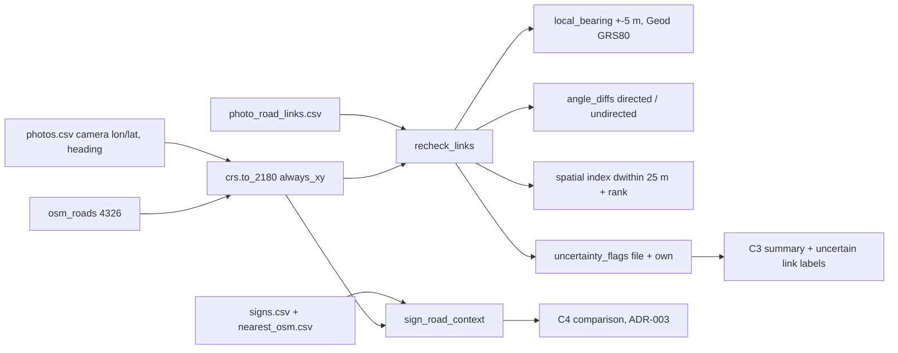
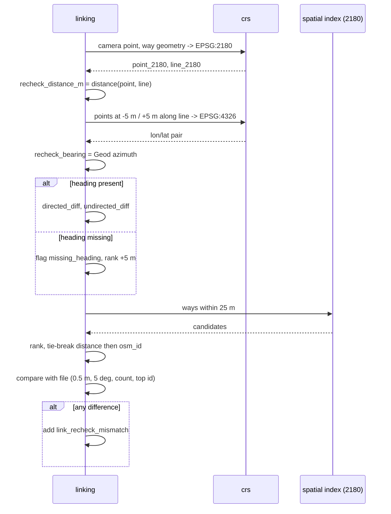

# ADR-002: CRS, EPSG:2180 i kontrola dopasowań zdjęcie–droga (C3)

**Data:** 2026-11-03
**Aktualizacja:** 2026-11-12, ustalenia z profilu M2 ([`reports/map-qa/profile.md`](../../reports/map-qa/profile.md)): `heading_diff_deg` jest nieskierowany (0–90), flaga `outside_standard_25m`, separator flag `;`, porównanie CRS przez `pyproj.CRS`, znaki spoza snapshotu (`outside_snapshot`)
**Status:** Accepted
**Relates to:** [`000-main-architecture.md`](000-main-architecture.md)

---

## 1. Zakres

**Obejmuje:**
- transformacje układów współrzędnych,
- odległości w metrach,
- lokalny azymut drogi,
- różnice kierunku,
- niezależną kontrolę linków z `photo_road_links.csv`,
- flagi niepewności i kontrolę C3 (AC-16–AC-19),
- wybór kierunku OSM do porównania ze znakiem w C4.

**Nie obejmuje:**
- normalizacji atrybutów (ADR-001),
- wywołań AI (ADR-003),
- eksportu (ADR-004). Ten ADR definiuje tylko transformację powrotną do WGS84.

---

## 2. Odnośniki do dokumentacji

| Biblioteka | Context7 ID lub dokumentacja | Zastosowanie |
|---|---|---|
| pyproj 3.8.0 | `/pyproj4/pyproj` | `Transformer.from_crs(..., always_xy=True)`, `Geod` (azymut geodezyjny) |
| GeoPandas 1.2.0 | `/geopandas/geopandas` | `to_crs`, indeks przestrzenny, zapytanie `dwithin` |
| Shapely 2.2.0 | `/shapely/shapely` | `distance`, `line_locate_point`, interpolacja punktu na linii |
| DuckDB spatial | `/duckdb/duckdb-web` | Nie używamy `ST_Transform` (D-01). Odnotowane ryzyko kolejności osi EPSG:4326 |
| Reguły snapshotu | `course-materials/exercise-data/map-qa/sources.json` (`links`), `README.md` (sekcja „Połączenia i układy współrzędnych”) | Promień 25 m, ranking, remisy, zakres `bearing_diff` |

---

## 3. Projekt komponentów

### 3.1 `crs`
- **Transformatory:** trzy, tworzone raz na uruchomienie, wszystkie z `always_xy=True`. Wejście i wyjście zawsze w kolejności lon/lat lub easting/northing.
  - EPSG:4326 → EPSG:2180 (OSM, zdjęcia, znaki),
  - OGC:CRS84 → EPSG:2180 (Overture),
  - EPSG:2180 → EPSG:4326 (eksport).
- **CRS z danych:** CRS warstwy bierzemy z metadanych GeoParquet. GeoPandas przy braku CRS przyjmuje OGC:CRS84. Jeśli metadane nie zgadzają się z `sources.json` (`osm.crs`, `overture.crs`), zwracamy `InputError(crs_mismatch)`.
  - **Porównanie przez obiekty `pyproj.CRS`, nie przez napisy.** Profil M2 pokazał, że GeoPandas zwraca CRS OSM jako pełny PROJJSON (WGS 84, `id: EPSG:4326`), a Overture jako `OGC:CRS84`. Porównujemy `CRS.from_user_input(sources_json_value) == gdf.crs`. Dla OSM akceptujemy też równość `to_epsg() == 4326`. Test obejmuje oba prawdziwe pliki.
- **Odległości:** tylko w EPSG:2180, po transformacji obu warstw. Raport zaokrągla do 0,1 m (AC-17). Nigdy nie liczymy odległości w stopniach.
- **Azymut geodezyjny:** liczymy `Geod(ellps="GRS80").inv` między dwoma punktami przeliczonymi z 2180 z powrotem do 4326. Wynik jest w stopniach od północy rzeczywistej, w zakresie [0, 360). To ta sama metoda co w `sources.json` („converted back to true-north geodesic bearing”). Zbieżność południków w 2180 nie wpływa wtedy na wynik.

### 3.2 `linking`: kontrola linków (D-06)

Dla każdego wiersza `photo_road_links.csv` z `osm_way_id`:

1. **Dystans:** punkt aparatu (z `photos.csv`) i geometria way OSM w 2180. Liczymy `recheck_distance_m`.
2. **Lokalna styczna:**
   - Rzutujemy punkt aparatu na linię (`line_locate_point`, odległość wzdłuż linii) i interpolujemy punkty w odległości −5 m i +5 m wzdłuż linii, przyciętej do jej końców.
   - Azymut geodezyjny od punktu −5 m do punktu +5 m daje `recheck_bearing`, czyli kierunek zgodny z kolejnością `node_ids`.
3. **Różnice kierunku** (gdy `heading` jest obecny):
   - `directed_diff` = najmniejszy kąt między `heading` a `recheck_bearing`, zakres 0–180.
   - `undirected_diff` = min(`directed_diff`, 180 − `directed_diff`), zakres 0–90. Odpowiada `bearing_diff` w pliku.
4. **Heading:**
   - `heading = 0.0` to północ.
   - Puste pole to `missing` (AC-18). Nie zamieniamy go na 0 ani na NaN traktowane jak liczba.
   - Bez heading nie liczymy różnic, a wiersz ma flagę `missing_heading`.
5. **Kandydaci w promieniu:**
   - Wszystkie way OSM w odległości ≤ 25 m od aparatu (indeks przestrzenny GeoPandas, zapytanie `dwithin` w 2180) i ich liczba `recheck_candidate_count`.
   - Dla każdego kandydata ranking zgodny z `sources.json`: `rank = distance_m + undirected_diff / 9`. Brak heading dodaje 5 m.
   - Remisy rozstrzygamy kolejno: mniejszy dystans, potem mniejszy `osm_id`.
6. **Porównanie z plikiem.** `recheck_status = mismatch`, gdy zachodzi którykolwiek z warunków:
   - |`recheck_distance_m` − `distance_m`| > 0,5 m,
   - różnica `recheck_bearing` i `way_bearing` > 5° (jako kąt na okręgu),
   - `recheck_candidate_count` ≠ `osm_candidate_count`,
   - pierwszy w rankingu kandydat to inny way niż `osm_way_id` z pliku.

   W przeciwnym razie `ok`. Przy `mismatch` dodajemy flagę `link_recheck_mismatch`. Linku nie zastępujemy własnym kandydatem.
7. **`ambiguous_candidates`:** przyjmujemy z pliku (alternatywa z rankiem w granicach 2 m). Nasz ranking służy tylko do kontroli z punktu 6.
8. **Wiersze bez `osm_way_id`** (`no_osm_within_25m`): `recheck_status = not_checked`. Sprawdzamy tylko, że w 25 m faktycznie nie ma way OSM. Jeśli jest, dajemy `link_recheck_mismatch`.

### 3.3 Flagi niepewności (C3)
- **Flagi z pliku:** `ambiguous_candidates`, `camera_against_way_direction`, `panorama_heading_ambiguous`, `poor_heading_alignment`, `missing_heading`, `service_way`, `boundary_crossing`, `overture_spatial_only`, `no_osm_within_25m` (AC-16).
  - W `candidate_flags` są rozdzielane znakiem `;`. Profil M2: wszystkie 9 flag występuje, a 146 z 561 zdjęć ma co najmniej jedną flagę z pliku.
- **Flagi liczone przez nas:**
  - `link_recheck_mismatch` (punkt 3.2),
  - `restricted_access`: way z tagiem `access` w {`private`, `no`, `customers`, `delivery`, `permit`},
  - `grade_separated_nearby`: way kandydata albo dowolny inny way w 25 m ma `bridge`, `tunnel` lub `layer` ≠ 0.

  Flagi z pliku i nasze pokazujemy osobno, w dwóch kolumnach.
- Link jest „niepewny”, gdy ma co najmniej jedną flagę z obu list. Podsumowanie C3 pokazuje liczbę na flagę i liczbę zdjęć z co najmniej jedną flagą.
- **Drogi serwisowe i z ograniczonym dostępem** nie są wykluczane. Ich kandydaci C1, C2 i C4 dostają etykietę „uncertain link” z listą flag (AC-19).
- **Panoramy:** wyznacznik `is_panorama` z `photos.csv` to heurystyka proporcji obrazu. Flaga `panorama_heading_ambiguous` ma pierwszeństwo przed różnicą kierunku: przy panoramie nie wnioskujemy o kierunku.

### 3.4 Wybór kierunku OSM dla znaku (C4)
- **Źródło:** `signs/nearest_osm.csv` (`osm_way_id`, `maxspeed`, `maxspeed_forward`, `maxspeed_backward`, `maxspeed_conditional`, `oneway`, `match_flags`, `distance_m`, `heading_diff_deg`) i `signs/signs.csv` (`compass_angle`, współrzędne aparatu).
- **Zakres `heading_diff_deg`:** profil M2 pokazał 0,01–87,86°, więc wartość jest **nieskierowana (0–90)** i nie odróżnia kierunków. Kierunek liczymy sami, metodą z punktu 3.2: `directed_diff` między `compass_angle` a styczną way. `compass_angle` jest wypełniony we wszystkich 119 wierszach `signs.csv`.
- **Dane do porównania:** 97 ze 119 najbliższych dróg ma `maxspeed`, tylko 2 mają tagi kierunkowe, a 9 ma `maxspeed_conditional`. 22 drogi bez wartości dadzą `osm_missing_speed` (ADR-003 §3.8).
- **Znaki spoza snapshotu** (profil M2 §5). Zestaw `signs/` obejmuje też inne miasta. Dla 24 ze 119 znaków `nearest_osm.source = osm_api`: Warszawa 11, Poznań 6, Kraków 4, Łódź, Wrocław i Gdańsk po 1. Ich `osm_way_id` **nie istnieje** w `osm_roads.parquet`, więc nie ma geometrii do stycznej ani pełnego `tags`. Tylko 95 znaków leży w bbox Krakowa z PRD i ma way w snapshocie.
  - **Decyzja (użytkownik, 2026-11-12, profil §10 pytanie 1, wariant A):** `sign_road_context` dla way spoza snapshotu zwraca `chosen_direction = unknown` i status `outside_snapshot`. Znak jest odczytywany i oceniany (ADR-003 §3.9), ale **nie jest porównywany z mapą**. Trafia do „not comparable / `outside_snapshot`”. Uzasadnienie: kontekst z OSM API ma inną datę niż snapshot (brak `osm_snapshot_timestamp`, jest `context_retrieved_at`), a PRD ogranicza obszar do Krakowa.
  - Rozpoznanie: `nearest_osm.source ≠ osm_roads.parquet` **albo** brak `osm_way_id` w `osm_roads`. Sprawdzamy oba warunki, a niezgodność między nimi jest błędem danych zgłaszanym w raporcie.
- **Way bez tagów kierunkowych:** porównujemy z `maxspeed` (`both`).
- **Way z `maxspeed:forward` lub `maxspeed:backward`:**
  - `directed_diff` ≤ 45° → wartość `forward`,
  - `directed_diff` ≥ 135° → wartość `backward`,
  - wartość pośrednia albo brak `compass_angle` → „not comparable / direction_unknown” (zgodnie z otwartym pytaniem z PRD).
- **Założenie:** aparat patrzący zgodnie z kierunkiem jazdy widzi znak dla tego kierunku. To heurystyka, więc raport zawiera wymagane zastrzeżenie (AC-29).
- **`oneway`** nie zmienia znaczenia `forward`/`backward`, bo te zawsze odnoszą się do kolejności węzłów. `oneway = -1` jest tylko flagą kontekstu w kandydacie.
- **Znaki z `match_flags`** niepustym dostają „uncertain link” z tymi flagami (rozdzielane `;`; 44 ze 119 wierszy). Lista flag w `nearest_osm.csv` jest szersza niż AC-16. Zawiera też **`outside_standard_25m`** (4 znaki: najbliższa droga dalej niż standardowe 25 m). Tę flagę przenosimy bez zmian, a raport i eksport C4 pokazują ją jak każdą inną flagę z pliku.

---

## 4. Struktury danych

- `PhotoLink` (ADR-000, sekcja 5) dostaje pola: `recheck_distance_m`, `recheck_bearing`, `recheck_candidate_count`, `recheck_top_osm_id`, `directed_diff`, `undirected_diff`, `recheck_status`, `own_flags` (lista), `file_flags` (lista).
- `SignRoadContext`: `photo_id`, `osm_way_id`, `osm_speed_raw` (wszystkie klucze prędkości), `chosen_direction` (`both` | `forward` | `backward` | `unknown`), `osm_value_kmh` lub status, `directed_diff`, `flags`.

---

## 5. Kontrakty interfejsów

- `to_2180(gdf) → gdf` oraz `to_4326(gdf) → gdf`. Funkcja rzuca `InputError(crs_mismatch)`, jeśli CRS ramki nie jest oczekiwany.
- `local_bearing(line_2180, point_2180, half_window_m=5) → stopnie [0, 360)`.
- `angle_diffs(heading | None, bearing) → (directed_diff | None, undirected_diff | None)`.
- `recheck_links(links, photos, osm_2180) → tabela PhotoLink z polami kontroli`.
- `uncertainty_flags(link, osm_tags) → (file_flags, own_flags)`.
- `sign_road_context(sign, nearest_osm_row, osm_2180) → SignRoadContext`.

---

## 6. Decyzje techniczne

### D-201: pyproj z `always_xy=True` jako jedyna ścieżka transformacji
**Status:** Accepted
**Data:** 2026-11-03
**Context:**
- Dokumentacja DuckDB spatial podaje, że EPSG:4326 ma kolejność osi [latitude, longitude], a `ST_Transform` wymaga `always_xy := true`.
- Pliki przechowują lon/lat. Zamiana osi daje błąd rzędu setek kilometrów, który nie rzuca wyjątku.

**Decision:** Wszystkie transformacje przez pyproj/GeoPandas z `always_xy=True`. Test zakresu dla znanego punktu jest obowiązkowy.

**Rejected alternatives:**
- `ST_Transform` w DuckDB: drugi mechanizm transformacji, a typowanie CRS jest eksperymentalne.

**Consequences:**
- (+) Jedno miejsce prawdy o kolejności osi.
- (-) Konwersja WKB między DuckDB a GeoPandas.

**Review trigger:** przejście obliczeń do DuckDB.

### D-202: Azymut geodezyjny z okna ±5 m
**Status:** Accepted
**Data:** 2026-11-03
**Context:** `sources.json` definiuje azymut jako styczną w oknie ±5 m wokół rzutu aparatu, przeliczoną na azymut geodezyjny od północy rzeczywistej.
**Decision:** Ta sama metoda w kontroli, z tolerancją 5° względem pliku.

**Rejected alternatives:**
- Azymut w siatce 2180: różni się o zbieżność południków, w Krakowie poniżej 1°, ale systematycznie.
- Azymut całego odcinka: błędny na łukach.

**Consequences:**
- (+) Porównywalność z plikiem.
- (-) Na krótkich way (< 10 m) okno jest przycinane.

**Review trigger:** więcej niż 5% `link_recheck_mismatch` z powodu azymutu.

### D-203: Kontrola zamiast zastępowania linków
**Status:** Accepted
**Data:** 2026-11-03
**Context:** Decyzja użytkownika: „gotowe + kontrola”.
**Decision:**
- Linki z pliku zostają kandydatami.
- Rozjazd kontroli daje flagę `link_recheck_mismatch`, link jest wtedy niepewny, a kandydat nie jest podmieniany.
- Tolerancje: 0,5 m, 5°, równa liczba kandydatów, ten sam pierwszy kandydat.

**Rejected alternatives:**
- Podmiana na własnego kandydata: dwa źródła prawdy.
- Brak kontroli: nie wykryjemy błędu CRS ani danych pomocniczych.

**Consequences:**
- (+) Wykrywalność.
- (-) Część linków może być oznaczona z powodu różnic numerycznych. Tolerancje są w konfiguracji.

**Review trigger:** zmiana reguły dopasowania w `sources.json`.

### D-204: Kierunek znaku z własnego `directed_diff`
**Status:** Accepted
**Data:** 2026-11-03
**Context:** Profil M2 potwierdził, że `heading_diff_deg` w `signs/nearest_osm.csv` ma zakres 0–90. Taka wartość nie pozwala odróżnić kierunków.
**Decision:** Liczymy `directed_diff` z `compass_angle` i stycznej way. Progi 45°/135°, strefa pośrednia daje `direction_unknown`.

**Rejected alternatives:**
- Wartość z pliku: niejednoznaczna.
- Zawsze `maxspeed`: błędne przy tagach kierunkowych.

**Consequences:**
- (+) Jawna reguła.
- (-) Kierunek aparatu nie jest kierunkiem jazdy, co wymaga zastrzeżenia w raporcie.

**Review trigger:** nowa wersja `signs/nearest_osm.csv` z kierunkowym `heading_diff_deg` (0–180). Profil M2 z 2026-11-12 potwierdził 0–90.

---

## 7. Diagramy

### Komponenty

### Sekwencja kontroli jednego linku

---

## 8. Strategia testów

### Scenariusze

| Scenariusz | Typ | Wejście | Oczekiwany wynik | Przypadki brzegowe |
|---|---|---|---|---|
| Kolejność osi | Unit | Rynek Główny lon 19,9373, lat 50,0614 (EPSG:4326) | easting w [560 000, 575 000], northing w [240 000, 255 000] | Zamienione osie dają wynik poza zakresem i test musi to wykryć |
| Powrót do 4326 | Unit | Ten sam punkt 4326 → 2180 → 4326 | Różnica < 1e−7° | CRS84 → 2180 daje ten sam wynik co 4326 → 2180 |
| Znana odległość | Unit | Dwa punkty 100,0 m od siebie (wyznaczone `Geod.fwd`) | Dystans w 2180 równy 100,0 ± 0,1 m | Punkty wzdłuż równoleżnika |
| Dystans do linii | Unit | Punkt 3 m od prostego odcinka | 3,0 m | Punkt za końcem odcinka (dystans do wierzchołka) |
| Azymut lokalny | Unit | Linia W→E, punkt w środku | 90° ± 0,5° | Okno przycięte na końcu linii |
| Heading 359 / 1 | Unit | heading 359, styczna 1° | `directed_diff` 2°, `undirected_diff` 2° | heading 0 to wartość, nie brak |
| Odwrotna geometria | Unit | heading 90, styczna 270° | `directed_diff` 180°, `undirected_diff` 0° | `oneway = -1` nie zmienia wyniku |
| Brak heading | Unit | Puste pole | `missing_heading`, brak różnic, rank +5 m | NaN z CSV nie staje się 0 |
| Heading 0 na prawdziwym wierszu | Integration | `panoramax_646ecfdd-ab57-4a28-b411-fb112ced3c97` (`heading = 0.0`) | Heading = 0° (północ), różnice policzone | 15 pustych heading w pliku = 15 flag `missing_heading` |
| Remis | Unit | Dwa way w identycznym dystansie | Wybór mniejszego dystansu, potem mniejszego `osm_id` | Rank w granicach 2 m |
| Kontrola zgodna | Integration | 5 prawdziwych linków bez flag z fixture'a | `recheck_status = ok` | — |
| Kontrola rozjazdu | Unit | Link z `distance_m` zmienionym o 1 m w kopii testowej | `link_recheck_mismatch` | 0,4 m nie daje flagi |
| Droga serwisowa | Integration | Prawdziwy link z `service_way` | Link niepewny, kandydat oznaczony „uncertain link” | `access = private` daje `restricted_access` |
| Most / tunel | Unit | Way z `bridge = yes` w 25 m | `grade_separated_nearby` | `layer = 0` bez flagi |
| Kierunek znaku | Unit | Way z `maxspeed:forward` / `:backward`, `compass_angle` 10° / 170° / 90° | forward / backward / `direction_unknown` | Brak `compass_angle` daje `direction_unknown` |
| Znak spoza snapshotu | Integration | Prawdziwy wiersz `nearest_osm.csv` z `source = osm_api` (np. `area = Warszawa`) | `outside_snapshot`, brak porównania z mapą, odczyt i ewaluacja nadal działają | Znak z Krakowa z `osm_api` (4 przypadki) |
| CRS z pliku | Integration | Prawdziwe `osm_roads.parquet` i `overture_segments.parquet` | Brak `crs_mismatch` (PROJJSON 4326 i CRS84) | Kopia z podmienionym CRS → `crs_mismatch` |

### Techniczne kryteria akceptacji
- **TAC-002-01:** Żadna funkcja odległości nie przyjmuje geometrii w CRS innym niż EPSG:2180. Wywołanie z 4326 rzuca błąd (test).
- **TAC-002-02:** Wszystkie `Transformer` w kodzie są tworzone z `always_xy=True`. Test przegląda moduł `crs`: brak innych miejsc tworzenia transformatorów (sprawdzane przez `grep` w CI).
- **TAC-002-03:** Na pełnym snapshocie co najmniej 95% linków z `osm_way_id` ma `recheck_status = ok`. Wynik poniżej uruchamia przegląd D-203, a nie zmianę tolerancji.
- **TAC-002-04:** Liczba zdjęć z co najmniej jedną flagą w raporcie równa się liczbie wierszy C3 w eksporcie.
