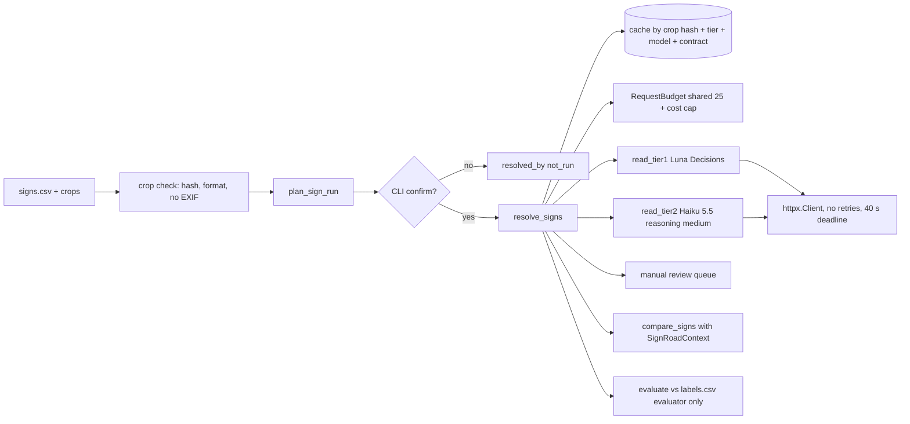
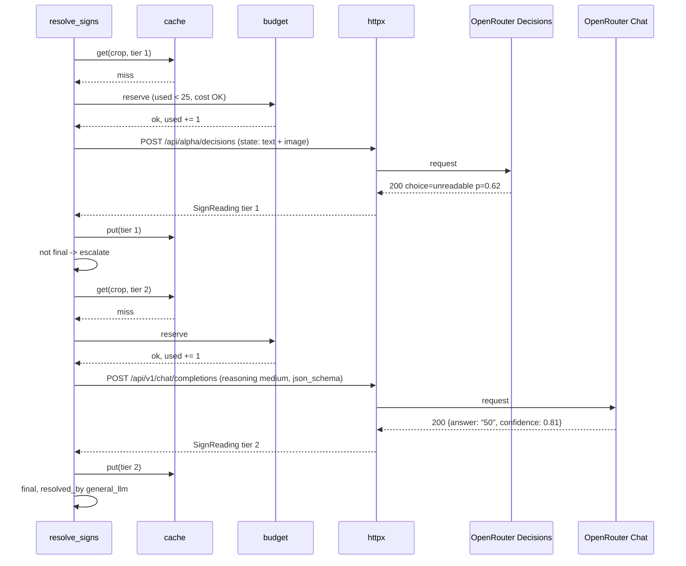
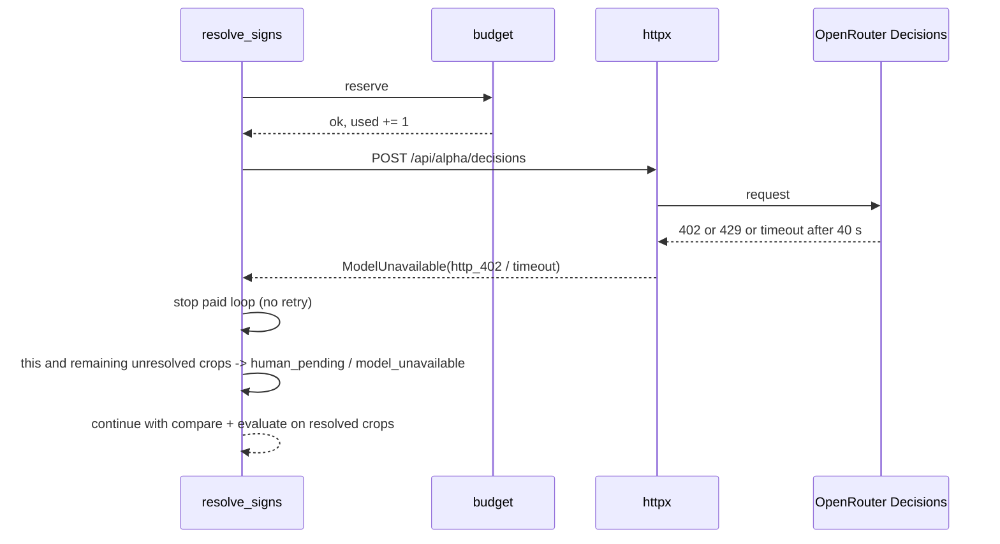
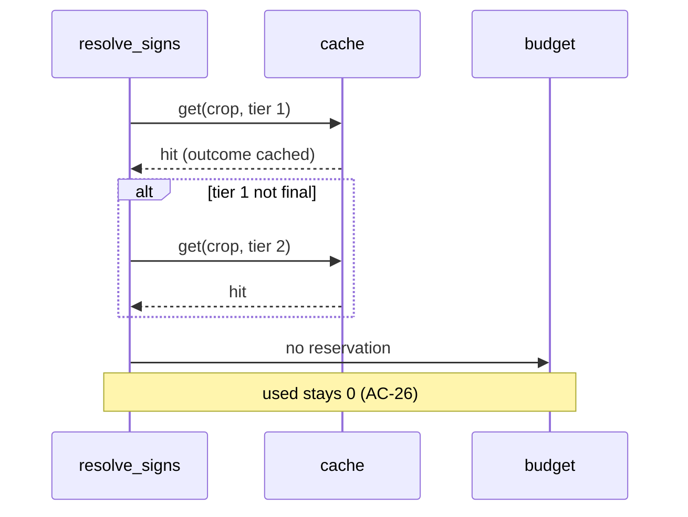

# ADR-003: Odczyt znaku B-33 przez AI, eskalacja, budżet i cache (C4)

**Data:** 2026-11-03
**Aktualizacja:** 2026-11-12, ustalenia z profilu M2 ([`reports/map-qa/profile.md`](../../reports/map-qa/profile.md)): mapowanie etykiet po `sign_value`, brak metadanych w wycinkach, wszystkie wartości etykiet w opcjach kroku 1, pochodzenie etykiet (zgodność dwóch modeli), znaki spoza snapshotu
**Status:** Accepted
**Relates to:** [`000-main-architecture.md`](000-main-architecture.md)

---

## 1. Zakres

**Obejmuje:**
- kontrakt kroku 1 (model decyzyjny) i kroku 2 (ogólny LLM),
- regułę eskalacji do kolejki ręcznej,
- próg, limit żądań i kosztu, timeout, brak ponowień,
- cache,
- porównanie z mapą,
- ewaluację względem etykiet,
- zapis prawdziwych odpowiedzi do mocków.

Pokrywa AC-20–AC-29 i AC-37 z PRD.

**Nie obejmuje:**
- wyboru kierunku OSM (ADR-002, punkt 3.4),
- prezentacji wyników (ADR-004).

---

## 2. Odnośniki do dokumentacji

| Element | Context7 ID lub dokumentacja | Zastosowanie |
|---|---|---|
| Decisions API | `/websites/openrouter_ai`; https://openrouter.ai/docs/api/api-reference/alphadecisions/submit-a-decisions-request | Kontrakt kroku 1 |
| Obrazy w Decisions | https://openrouter.ai/docs/guides/community/multimodal-decisions | Obraz jako data URL w `state` |
| Chat completions, obrazy | https://openrouter.ai/docs/guides/overview/multimodal/overview | Obraz w `messages` kroku 2 |
| Reasoning | https://openrouter.ai/docs/guides/best-practices/reasoning-tokens.md | `reasoning.effort = "medium"` |
| Structured outputs | https://openrouter.ai/docs/guides/features/structured-outputs.md | `response_format` `json_schema`, strict |
| httpx 0.28.1 | https://www.python-httpx.org/ | Klient, limity czasu, transport bez ponowień |
| pytest-httpx 0.36.2 | https://colin-b.github.io/pytest_httpx/ | Odtwarzanie zapisanych odpowiedzi |
| SDK `openrouter` 1.3.107 (odrzucony, D-05) | `/openrouterteam/python-sdk` | Tylko porównanie: domyślne ponowienia `backoff` |

**Fakty niezweryfikowane w dniu badania:**
- ceny i opóźnienia `openai/gpt-6-luna-decisions` (strona modelu zwraca 404, a modelu nie ma w `/api/v1/models`),
- limity szybkości Decisions API,
- obecność `usage.cost` w odpowiedzi chat completions.

Pierwsze prawdziwe wywołania mają te fakty zmierzyć i zapisać w sekcji 9.

---

## 3. Projekt komponentów

### 3.1 Wybór próbki
- **Źródło:** `signs/signs.csv` (119 wycinków) w kolejności rosnącej `photo_id`.
- **Kolejność wycinków:** najpierw te z wynikiem w cache, potem nieodczytane.
- **Rozmiar próbki nowych wycinków:** `floor(max_requests / 2)`, czyli domyślnie 12. Gwarantuje to, że najgorszy przypadek (każdy wycinek eskaluje) mieści się w limicie (PRD, sekcja 12). Opcja `--sign-sample` może tę liczbę tylko zmniejszyć.
- **Wycinki spoza próbki** dostają `resolved_by = not_run`.

### 3.2 Kontrola obrazu przed wysłaniem (fail closed)
- **Plik:** `signs/crops/<photo_id>.jpg`. Hash bajtów porównujemy z `crop_sha256` w `signs.csv`. Niezgodność albo brak pliku daje `request_outcome = not_sent`, `resolved_by = human_pending`, `manual_reason = model_unavailable`, a w szczegółach `crop_invalid`.
- **Format:** tylko JPEG lub PNG (sprawdzane po sygnaturze bajtów).
- **Metadane:** wycinek nie może zawierać metadanych lokalizacyjnych. Plik JPEG z segmentem APP1 (EXIF/XMP) albo PNG z chunkiem `eXIf` nie jest wysyłany: `not_sent / metadata_present`, wycinek trafia do kolejki ręcznej. Nie przetwarzamy obrazu ponownie, żeby nie dodawać zależności i nie zmieniać hashu.
- **Stan danych (profil M2):** 119/119 wycinków to JPEG z hashem zgodnym z `crop_sha256` i bez segmentu APP1. W dostarczonej próbce kontrola nie blokuje żadnego wycinka. Testy fail-closed robimy na zmodyfikowanych kopiach w tmp.
- **Wysyłane bajty:** obraz trafia do żądania jako data URL base64 (`data:image/jpeg;base64,…`) dokładnie z bajtów pliku.

### 3.3 Krok 1: model decyzyjny
- **Endpoint:** `POST https://openrouter.ai/api/alpha/decisions`.
- **Nagłówki:** `Authorization: Bearer <OPENROUTER_API_KEY>`, `Content-Type: application/json`. Brak `session_id`, `user`, `trace` i `x-session-id`, żeby nie przekazywać identyfikatorów.
- **Ciało żądania:**
  - `model`: `openai/gpt-6-luna-decisions`.
  - `state`: tablica dwóch elementów:
    - neutralny tekst „An image crop from a street-level photograph.” (stała `STATE_TEXT_V1`),
    - obraz w kształcie `{type: image_url, image_url: {url: <data URL>}}`.

    Nic więcej: bez współrzędnych, identyfikatorów, nazw plików, wartości z mapy, detekcji Mapillary ani etykiet (AC-21).
  - `questions`: jedno pytanie o kluczu `b33_value`, `type = choice`.
    - `instructions` (stała `QUESTION_V1`): „Is there a round Polish B-33 maximum speed limit sign (red ring, black number) in this image? If yes, which number does it show?”
    - `criteria`, czyli opcja → wskazówka:
      - `10`, `20`, `30`, `40`, `50`, `60`, `70`, `80`, `90`, `100`, `110`, `120`, `130`, `140`: „a B-33 sign showing this number”,
      - `other`: „a B-33 sign whose number is not in this list”,
      - `none`: „no B-33 sign; includes zone signs and end-of-limit signs”,
      - `unreadable`: „a sign is present but its number cannot be read”.
- **Format obrazu:** kształt w `state` pochodzi z przewodnika multimodalnego. Referencja API pokazuje też pole `assets`, opisane w przewodniku jako format TypeSafe. Jeśli pierwsze prawdziwe żądanie zwróci 400 z powodu formatu, płatna pętla staje (punkt 3.6), odpowiedź jest zapisywana, a ADR poprawiany przed kolejnym uruchomieniem. Nie ma automatycznego przełączania formatu.
- **Odpowiedź:** `answers.b33_value.choice`, `answers.b33_value.confidence`, `answers.b33_value.probabilities` (mapa opcja → p), `usage.input_tokens`, `usage.output_tokens`, `usage.cost`, `id`, `model`, `provider`.
- **Interpretacja:**
  - `answer = choice`.
  - `probability = probabilities[choice]`. Pole `confidence` zapisujemy osobno, nie używamy go do progu.
  - Odpowiedź z `choice` spoza listy opcji albo bez mapy `probabilities` to `invalid_response`.
- **Ostateczność (AC-22b):** wynik jest ostateczny (`resolved_by = decision_model`), gdy `choice` jest liczbą z listy albo `none` i `probability ≥ threshold`. `other`, `unreadable` albo prawdopodobieństwo poniżej progu prowadzą do eskalacji do kroku 2.

### 3.4 Krok 2: ogólny LLM
- **Endpoint:** `POST https://openrouter.ai/api/v1/chat/completions`, z tymi samymi nagłówkami.
- **Ciało żądania:**
  - `model`: `anthropic/claude-haiku-5.5`.
  - `messages`: jedna wiadomość `user` o treści:
    - tekst `QUESTION_V1` plus „Answer with JSON only.”,
    - obraz `image_url` z tym samym data URL.

    Bez odpowiedzi kroku 1 (AC-21) i bez komunikatu systemowego z kontekstem mapy.
  - `reasoning`: `{effort: "medium"}`.
  - `max_tokens`: 4000, bo tokeny rozumowania liczą się do limitu.
  - `response_format`: `{type: "json_schema", json_schema: {name: "b33_reading", strict: true, schema: SCHEMA_V1}}`.
  - `provider`: `{require_parameters: true}`, żeby routing trafił tylko do dostawców obsługujących schemat.
- **`SCHEMA_V1`:** obiekt bez dodatkowych pól, z trzema polami wymaganymi:
  - `answer`: tekst z enumem `10`…`140` (co 10), `other_value`, `none`, `unreadable`,
  - `value_kmh`: liczba całkowita 5–140 albo null,
  - `confidence`: liczba 0–1.
- **Interpretacja:**
  - Treść z `choices[0].message.content` parsujemy jako JSON i walidujemy wobec schematu.
  - `answer = other_value` jest ważne tylko z `value_kmh` podzielnym przez 5. Wtedy wynikiem jest `value_kmh`, inaczej `invalid_response`.
  - `probability = confidence`.
- **Ostateczność (AC-22c):** wynik jest ostateczny (`resolved_by = general_llm`), gdy odpowiedź jest liczbą albo `none` i `confidence ≥ threshold`. W pozostałych przypadkach wycinek trafia do kolejki ręcznej: `human_pending`, `manual_reason = unreadable` albo `below_threshold`.

### 3.5 Próg
- Jeden próg dla obu kroków, domyślnie 0,7, ustalany przed uruchomieniem (`--threshold`).
- Pokazujemy go w potwierdzeniu CLI i w nagłówku raportu. W trakcie uruchomienia jest niezmienny (AC-22a).
- Rozkłady i odpowiedzi zapisane w cache pozwalają później ocenić inne progi bez nowych żądań.

### 3.6 Budżet, limit czasu, brak ponowień
- **Licznik żądań:**
  - Wspólny dla obu kroków. Zwiększamy go *przed* wysłaniem, więc liczy się każda próba, także nieudana (AC-23).
  - Limit to `max_requests` (1–25, domyślnie 25). Trafienie w cache nie zwiększa licznika.
  - Przed żądaniem sprawdzamy, czy licznik < limit. Jeśli nie, ten i wszystkie pozostałe nierozstrzygnięte wycinki dostają `budget_exhausted` i trafiają do kolejki ręcznej.
- **Limit kosztu:**
  - `--max-cost-usd`, domyślnie 0,50 USD. Sumujemy `usage.cost` z odpowiedzi.
  - Przed każdym żądaniem: jeśli suma + największy dotąd zaobserwowany koszt jednego żądania tego kroku > limit, zwracamy `budget_exhausted`.
  - Brak `usage.cost` w odpowiedzi jest odnotowany jako `cost_unknown`. Wtedy działa tylko limit żądań, a raport to pokazuje.
- **Plan przed potwierdzeniem** (AC-23): liczba nowych żądań kroku 1, najgorszy przypadek kroku 2 (= liczba nowych żądań kroku 1), limit, próg i limit kosztu.
- **Limit czasu** (AC-25): całkowity termin 40 s na żądanie, liczony zegarem monotonicznym od wysłania.
  - Limity httpx: połączenie 5 s, zapis 5 s, pula 5 s, odczyt 40 s.
  - Termin całkowity pilnujemy osobno: odpowiedź po 40 s jest traktowana jako `timeout`, nawet jeśli httpx jej nie przerwał.
  - Dokładny mechanizm należy sprawdzić w dokumentacji httpx (Context7) przy implementacji.
- **Brak ponowień** (AC-24):
  - Jeden `httpx.Client` z domyślnym transportem (0 ponowień). Nie ustawiamy `HTTPTransport(retries=…)`, nie używamy bibliotek ponowień ani SDK.
  - Pierwszy błąd w którymkolwiek kroku kończy płatną pętlę. Błąd to: status ≠ 2xx, `timeout`, błąd sieci, niepoprawny JSON, odpowiedź niezgodna ze schematem albo `choice` spoza opcji.
  - Wycinek, na którym nastąpił błąd, oraz wszystkie pozostałe nierozstrzygnięte dostają `model_unavailable` i trafiają do kolejki ręcznej.
  - Wycinki już rozstrzygnięte i wyniki z cache zostają.
- **Klucz:**
  - `OPENROUTER_API_KEY` czytamy wyłącznie w `ai_client` w chwili budowy nagłówka.
  - Brak klucza przy `--with-signs` oznacza zero żądań, komunikat „brak klucza”, `resolved_by = not_run` i dalsze wykonanie C1–C3 (AC-37).
  - Logger httpx ma poziom WARNING. Nagłówki żądań nigdy nie są logowane.

### 3.7 Cache
- **Lokalizacja:** `course-materials/exercise-data/map-qa/data/cache/ai/` (ignorowane przez git), nadpisywana przez `MAP_QA_CACHE_DIR`.
- **Klucz:** SHA-256 z połączenia: `crop_sha256`, `tier`, `model_id`, `QUESTION_V1`/`STATE_TEXT_V1`/`SCHEMA_V1` (wersje) i stałej wersji kontraktu. Zmiana modelu, pytania albo schematu oznacza nowy klucz.
- **Wpis:** jeden plik JSON na klucz. Zawiera:
  - datę,
  - endpoint,
  - streszczenie żądania (model, pytanie, wersje; obraz zastąpiony jego SHA-256, bez nagłówków),
  - status HTTP,
  - wybrane nagłówki odpowiedzi (`content-type`, `date`, identyfikator żądania, jeśli jest),
  - pełne ciało odpowiedzi bez zmian,
  - wynik interpretacji.
- **Co trafia do cache:** tylko odpowiedzi 2xx, które przeszły interpretację. Błędy nie są cache'owane, żeby kolejne uruchomienie mogło je powtórzyć po świadomej decyzji użytkownika.
- **Odczyt:** trafienie daje `request_outcome = cached` i pomija licznik. Ponowne uruchomienie na tych samych wycinkach wykonuje zero żądań (AC-26).

### 3.8 Porównanie z mapą
- Tylko wycinki z wynikiem ostatecznym AI (AC-27).
- Tylko znaki z way w snapshocie. 24 ze 119 znaków ma kontekst z OSM API spoza snapshotu i dostaje „not comparable / `outside_snapshot`” (ADR-002 §3.4; decyzja użytkownika 2026-11-12, wariant A). Wybór próbki (§3.1) i ewaluacja (§3.9) obejmują nadal wszystkie 119 wycinków.
- **`SignRoadContext`** (ADR-002, punkt 3.4):
  - wartość liczbowa AI ≠ `osm_value_kmh` daje `C4 / sign_mismatch`,
  - brak wartości OSM daje `C4 / osm_missing_speed` (uzupełnienie C1),
  - `direction_unknown` albo `not_numeric` po stronie OSM dają „not comparable”.
- Odpowiedź `none` nie tworzy kandydata.
- **Kandydat pokazuje:** krok rozstrzygający, odpowiedzi obu kroków z prawdopodobieństwami, `mapillary_value` (tylko do prezentacji, nigdy jako wejście modelu) i wszystkie surowe klucze prędkości OSM.

### 3.9 Ewaluacja
- `signs/labels.csv` czyta wyłącznie moduł `signs.evaluate`, po zakończeniu rozstrzygania. Żaden moduł wywołujący AI go nie importuje (TAC-003-04).
- **Mapowanie etykiet** (kodowanie potwierdzone w profilu M2). Decyduje **wyłącznie `sign_value`**:
  - liczba (w próbce 20–120) → ta liczba,
  - `none` → `none`,
  - `unreadable` → `unreadable`.
  - Pole `negative_type` (`no_speed_sign`, `no_entry`, `zone_end`, `zone`, `weight`, `no_overtaking`, `cancelled_sign`, `false_positive_object`, `no_stopping`, `limit_end`, `unreadable`) służy tylko do opisu w raporcie. **Nie mapujemy po nim**, bo ma je też wiersz `unreadable`.
  - Inna wartość `sign_value` wyklucza wiersz z ewaluacji z kodem `label_unparsable`, raportowanym z licznością.
- **Etykiety w mianowniku:** tylko `status = certain`. Etykiety `uncertain` raportujemy osobno, z liczebnością. Profil M2: 115 `certain` (89 liczbowych, 25 `none`, 1 `unreadable`) i 4 `uncertain` (wszystkie `none`).
- **Etykieta `unreadable`** (decyzja użytkownika 2026-11-12, profil §10 pytanie 3, wariant A): wynik AI ostateczny (liczba lub `none`) dla takiego wycinka liczymy jako błędny. Wycinek, który trafił do kolejki ręcznej, jest poza mianownikiem, jak każdy inny w kolejce.
- **Pochodzenie etykiet** (README danych, profil M2 §5): odczyt agenta Codex i niezależny odczyt modelu GLM-5.3-Flash. `certain` oznacza zgodność dwóch modeli, nie pewność terenową. Raport podpisuje więc metryki AC-28 jako **„zgodność z roboczą referencją”**, a nie „poprawność”, i dodaje zdanie: „Etykiety referencyjne pochodzą z odczytów modeli AI i nie są prawdą terenową”. Rozbieżność AI z etykietą wymaga obejrzenia wycinka przez człowieka.
- Wszystkie liczbowe etykiety w próbce mieszczą się w opcjach kroku 1 (10–140 co 10). Opcja `other` nie powinna więc wystąpić jako poprawna odpowiedź.
- **Metryki** (AC-28), wszystkie jako „poprawne / ocenione”:
  - (a) ostateczne wyniki kroku 1,
  - (b) ostateczne wyniki kroku 2,
  - (c) wszystkie wyniki ostateczne AI.
- **Dodatkowo:**
  - pokrycie (ostateczne / przetworzone),
  - liczebność kolejki ręcznej według `manual_reason`,
  - surowe accuracy kroku 1 przed progiem, na wszystkich odpowiedziach kroku 1.
- Wycinki w kolejce ręcznej nie są liczone jako poprawne ani błędne.

### 3.10 Stany końcowe
- Każdy wycinek z próbki kończy w dokładnie jednym stanie `resolved_by` ∈ {`decision_model`, `general_llm`, `human_pending`, `not_run`} (AC-22e). Pipeline sprawdza sumę przed zapisem wyników.

---

## 4. Struktury danych

- `SignReading`, `SignResolution` (ADR-000, sekcja 5).
- `RequestBudget`: `limit`, `used`, `cost_limit_usd`, `cost_used_usd`, `max_cost_seen_per_tier`, `stopped_reason` (`none` | `budget_exhausted` | `model_unavailable` | `cost_limit`), `stopped_at_photo_id`.
- `CacheEntry`: pola z punktu 3.7.
- `CapturedFixture`: `captured_at`, `endpoint`, `model`, `contract_versions`, `httpx_version`, `request_summary` (bez obrazu i nagłówków), `status`, `headers` (lista dozwolonych), `body` (verbatim).

---

## 5. Kontrakty interfejsów

- **`plan_sign_run(sample, cache, config) → SignPlan`**
  - Wyjście: liczba wycinków w cache, nowe żądania kroku 1, najgorszy przypadek kroku 2, limit, próg i limit kosztu.
  - Bez I/O sieci.
- **`read_tier1(crop_bytes, budget, client) → SignReading`**
  - Wejście: tylko bajty obrazu i budżet.
  - Błędy: `ModelUnavailable(reason)` albo `BudgetExhausted`.
- **`read_tier2(crop_bytes, budget, client) → SignReading`**: jak wyżej.
- **`resolve_signs(sample, plan, budget, cache, client, threshold) → lista SignResolution + SignReading`**
  - Zatrzymuje pętlę przy pierwszym `ModelUnavailable`.
- **`compare_signs(resolutions, contexts) → kandydaci C4, not comparable`.**
- **`evaluate(resolutions, labels_path) → metryki`.**
- **Błędy HTTP:** każdy status ≠ 2xx mapujemy na `ModelUnavailable(http_<status>)`. Treść odpowiedzi zapisujemy do logu uruchomienia po usunięciu nagłówków. Logika nie zależy od treści błędu.

---

## 6. Decyzje techniczne

### D-301: Pytanie `choice` z jawnymi `none`, `unreadable` i `other`
**Status:** Accepted
**Data:** 2026-11-03
**Context:**
- Decisions API nie ma pola abstencji. Odpowiedź `choice` zwraca mapę `probabilities`.
- PRD wymaga odpowiedzi: liczba, `none` albo `unreadable`.

**Decision:**
- 14 opcji liczbowych (10–140 co 10) plus `other`, `none` i `unreadable`.
- `other` zawsze eskaluje do kroku 2, który zwraca dokładną liczbę.

**Rejected alternatives:**
- Pytanie `score` z liczbą: brak rozkładu na `none`/`unreadable`.
- Wszystkie wartości co 5: rozkład na 28+ opcjach rozmywa prawdopodobieństwo.

**Consequences:**
- (+) Prawdopodobieństwo pod próg.
- (+) Rzadkie wartości (np. 5, 15, 25) obsługuje krok 2.
- (-) Takie wartości zawsze kosztują dwa żądania.

**Review trigger:** więcej niż 20% wyników `other` w kroku 1.

### D-302: Krok 2 nie widzi odpowiedzi kroku 1
**Status:** Accepted
**Data:** 2026-11-03
**Context:** AC-21 oraz ryzyko zakotwiczenia drugiego modelu.
**Decision:** Identyczne pytanie i obraz, bez wyniku kroku 1. Obie odpowiedzi są widoczne tylko w raporcie i w kolejce ręcznej.

**Rejected alternatives:**
- Przekazanie odpowiedzi kroku 1 „do weryfikacji”: model może ją potwierdzać bez patrzenia.

**Consequences:**
- (+) Niezależność ocen.
- (-) Brak możliwości „dopytania”.

**Review trigger:** brak.

### D-303: Wspólny limit 25 żądań, limit kosztu i próbka `floor(limit/2)`
**Status:** Accepted
**Data:** 2026-11-03
**Context:** Decyzja użytkownika: wspólny limit dla obu modeli. Ceny kroku 1 są niezweryfikowane.
**Decision:**
- Licznik zwiększany przed wysłaniem.
- Domyślna próbka 12 nowych wycinków.
- Dodatkowy limit kosztu 0,50 USD z `usage.cost`.

**Rejected alternatives:**
- Osobne limity dla kroków: odrzucone przez użytkownika.
- Sam limit kosztu: cena nieznana przed pierwszym wywołaniem.

**Consequences:**
- (+) Najgorszy przypadek mieści się w limicie.
- (-) Większa próbka wymaga kilku uruchomień (z cache).

**Review trigger:** zmiana budżetu kursowego.

### D-304: Kontrola metadanych zamiast ponownego kodowania obrazu
**Status:** Accepted
**Data:** 2026-11-03
**Context:** Model ma dostać tylko obraz. EXIF może zawierać GPS i znaczniki czasu.
**Decision:** Odrzucenie (fail closed) wycinka z segmentem EXIF/XMP. Bez Pillow i bez zmiany bajtów.

**Rejected alternatives:**
- Ponowne kodowanie przez Pillow: nowa zależność, inny hash niż w `signs.csv`.

**Consequences:**
- (+) Gwarancja braku metadanych.
- (-) Wycinek z EXIF trafia do kolejki ręcznej.

**Review trigger:** nowa próbka wycinków z metadanymi. Profil M2 z 2026-11-12: 0/119 z APP1.

### D-305: Cache tylko odpowiedzi poprawnych
**Status:** Accepted
**Data:** 2026-11-03
**Context:** AC-26 i powtarzalność. Błędy mogą być przejściowe.
**Decision:**
- Cache po hashu obrazu i wersji kontraktu.
- Zapisujemy wyłącznie odpowiedzi 2xx po interpretacji.

**Rejected alternatives:**
- Cache błędów: utrwala awarie przejściowe.
- Cache po `photo_id`: nie wykrywa zmiany obrazu.

**Consequences:**
- (+) Zero kosztu przy powtórce.
- (-) Ręczne czyszczenie przy zmianie modelu nie jest potrzebne, bo klucz zawiera model.

**Review trigger:** zmiana kontraktu (nowa wersja stałych).

---

## 7. Diagramy

### Komponenty

### Sekwencja: wycinek z eskalacją do kroku 2

### Sekwencja: błąd i zatrzymanie płatnej pętli

### Sekwencja: powtórne uruchomienie z cache

---

## 8. Strategia testów

### Zasada mocków (obowiązkowa)
1. **Zapis odpowiedzi kroku 1:** przed testami integracyjnymi `ai_client` wykonujemy jedno prawdziwe żądanie kroku 1, po zgodzie użytkownika, w ramach limitu. Zapisujemy je jako `CapturedFixture` w `app/tests/fixtures/openrouter/tier1-<data>.json`:
   - status, dozwolone nagłówki i ciało bez zmian,
   - streszczenie żądania bez obrazu i bez `Authorization`,
   - data, endpoint, model i wersja httpx.
2. **Zapis odpowiedzi kroku 2:** to samo w `tier2-<data>.json`.
3. **Zapis błędu 401:** żądanie bez nagłówka `Authorization`, czyli bez klucza i bez kosztu, zapisane jako `error-401-<data>.json`.
4. **Mocki pytest-httpx** odtwarzają wyłącznie te pliki. Kształtów odpowiedzi 402, 429 i 5xx nie zmyślamy. Logika błędów zależy tylko od statusu (punkt 5), więc test błędu używa zapisanej odpowiedzi 401. Testy treści dla innych statusów powstaną dopiero, gdy będzie bezpieczny zapis. Do tego czasu to brakujący warunek, zapisany w raporcie etapu.
5. **Timeout i błąd sieci** symulujemy wyjątkiem transportu httpx (to nie jest kształt odpowiedzi API).
6. **Brak zapisu:** bez zapisanego pliku test integracyjny jest oznaczony jako pominięty, z powodem „brak capture”. Nie zastępujemy go wymyślonym JSON.

### Scenariusze

| Scenariusz | Typ | Wejście | Oczekiwany wynik | Przypadki brzegowe |
|---|---|---|---|---|
| Treść żądania kroku 1 | Unit | Bajty wycinka | Ciało zawiera tylko `model`, `state` (tekst + obraz), `questions`. Brak `photo_id`, współrzędnych, `mapillary_value` i etykiet | Sprawdzenie wszystkich kluczy rekurencyjnie |
| Treść żądania kroku 2 | Unit | Bajty wycinka, wynik kroku 1 | Brak wyniku kroku 1 w ciele, jest `reasoning.effort = medium` i `json_schema` strict | — |
| Ostateczność kroku 1 | Unit | p = 0,70 / 0,69 dla `50` | final / eskalacja | `none` p 0,9 jest final, `unreadable` p 0,99 eskaluje, `other` zawsze eskaluje |
| Ostateczność kroku 2 | Unit | confidence 0,7 / 0,69 | final / kolejka `below_threshold` | `other_value` z `value_kmh` 35 jest final, z 33 to `invalid_response` |
| Interpretacja zapisanej odpowiedzi | Integration | `tier1-<data>.json` przez pytest-httpx | `SignReading` z `probabilities` i `usage.cost` | Pominięty z powodem, jeśli nie ma capture |
| Limit żądań | Unit | 13 wycinków, wszystkie eskalują, limit 25 | Domyślnie 12 w próbce; użytych żądań ≤ 25 | Limit 1: jedno żądanie, reszta `budget_exhausted` |
| Licznik przed wysłaniem | Unit | Pierwsze żądanie kończy się timeoutem | `used = 1` | Błąd sieci też liczy się do limitu |
| Brak ponowień | Integration | Zapisana odpowiedź 401 dla pierwszego żądania | Mock wywołany dokładnie raz. Pozostałe wycinki `model_unavailable`, kolejka ręczna | Błąd w kroku 2 zatrzymuje też dalszy krok 1 |
| Timeout 40 s | Unit | Transport z opóźnieniem > 40 s (zegar wstrzyknięty) | `timeout`, pętla zatrzymana | Odpowiedź po 39 s jest akceptowana |
| Cache | Integration | Dwa uruchomienia na tmp cache | Drugie: zero wywołań mocka, `used = 0` | Zmiana `model_id` daje nowy klucz |
| Błąd nie trafia do cache | Integration | Pierwsze uruchomienie z 401 | Brak wpisu w cache | — |
| Metadane | Unit | Kopia wycinka z dodanym segmentem APP1 | `not_sent / metadata_present`, zero żądań | PNG z `eXIf` |
| Hash wycinka | Unit | Zmieniony bajt | `crop_invalid`, kolejka ręczna | Brak pliku |
| Brak klucza | Integration | `--with-signs` bez zmiennej | Zero żądań, C1–C3 zapisane | Pusta zmienna traktowana jak brak |
| Ewaluacja | Unit | Rozstrzygnięcia + fixture etykiet | Trzy metryki z licznikiem i mianownikiem, kolejka poza mianownikiem | Etykiety `uncertain` osobno |
| Mapowanie etykiet | Unit | Prawdziwe wiersze `labels.csv`: liczba, `none` + `no_entry`, `unreadable` + `negative_type = unreadable` | 50 / `none` / `unreadable` (nie `none`) | Nieznane `sign_value` → `label_unparsable` |
| Izolacja etykiet | Unit | Import modułów | `ai_client`, `signs.resolve` nie czytają `labels.csv` (test sprawdzający otwierane pliki) | — |
| Stany końcowe | Unit | Dowolny przebieg | Suma czterech stanów = liczba wycinków w próbce | `not_run` przy odmowie potwierdzenia |

### Techniczne kryteria akceptacji
- **TAC-003-01:** W żadnym miejscu kodu nie powstaje transport httpx z ponowieniami ani nie jest używany SDK `openrouter` czy klient OpenAI (sprawdzane `grep` w CI i testem importów).
- **TAC-003-02:** Licznik żądań po dowolnym przebiegu testowym jest ≤ `max_requests`. Przekroczenie rzuca `AssertionError` w samym `RequestBudget`.
- **TAC-003-03:** Każdy plik w `app/tests/fixtures/openrouter/` ma pola `captured_at`, `endpoint`, `model` i nie zawiera tekstu `Authorization` ani `Bearer` (test).
- **TAC-003-04:** Tylko moduł `signs.evaluate` otwiera `signs/labels.csv` (test z podmienionym `open`).
- **TAC-003-05:** Pierwsze prawdziwe uruchomienie C4 kończy się zapisem w sekcji 9 tego ADR: zmierzony koszt na żądanie per krok, mediana czasu odpowiedzi i potwierdzony kształt obrazu w `state`.

---

## 9. Pomiary do uzupełnienia po pierwszym prawdziwym uruchomieniu

| Pomiar | Krok 1 (Luna) | Krok 2 (Haiku 5.5) |
|---|---|---|
| Koszt na żądanie (`usage.cost`, USD) | do zmierzenia | do zmierzenia |
| Mediana czasu odpowiedzi (s) | do zmierzenia | do zmierzenia |
| Przyjęty kształt obrazu | do potwierdzenia (`state` data URL) | `messages` `image_url` |
| Data i liczba żądań pomiaru | — | — |
