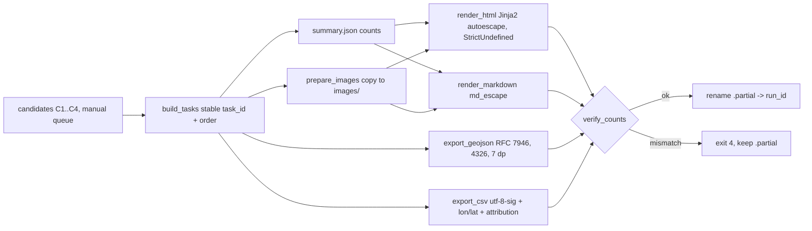
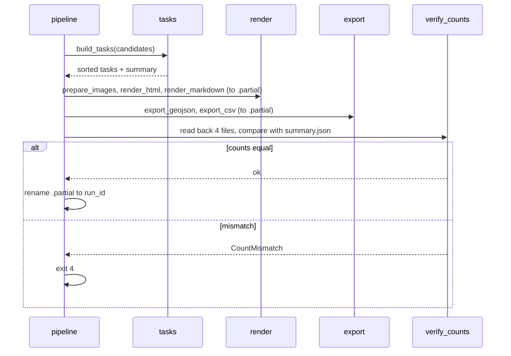

# ADR-004: Raport Markdown/HTML, eksport GeoJSON i CSV

**Data:** 2026-11-03
**Status:** Accepted
**Relates to:** [`000-main-architecture.md`](000-main-architecture.md)

---

## 1. Zakres

**Obejmuje:**
- katalog uruchomienia,
- stabilne `task_id`,
- szablony Markdown i HTML,
- miniatury i atrybucje,
- eksport GeoJSON (RFC 7946) i CSV,
- kontrolę spójności liczników,
- teksty obowiązkowe.

Pokrywa AC-30–AC-36 i AC-38 z PRD oraz sekcję 9 PRD.

**Nie obejmuje:**
- obliczeń kontroli (ADR-001–003),
- dashboardu (poza zakresem, D-07).

---

## 2. Odnośniki do dokumentacji

| Biblioteka | Context7 ID lub dokumentacja | Zastosowanie |
|---|---|---|
| Jinja2 3.1.6 | `/pallets/jinja`, `/websites/jinja_palletsprojects_en_stable` | `PackageLoader`, `select_autoescape`, `StrictUndefined` |
| GeoJSON RFC 7946 | https://www.rfc-editor.org/rfc/rfc7946 | WGS84 lon/lat, brak członu `crs`, foreign members |
| pyproj 3.8.0 | `/pyproj4/pyproj` | Transformacja 2180 → 4326 przed eksportem (ADR-002) |
| syrupy 6.1.1 | https://pypi.org/project/syrupy/ | Golden files Markdown/HTML |
| Atrybucja OSM | https://www.openstreetmap.org/copyright | Tekst „© OpenStreetMap contributors” |
| Atrybucja Overture | https://docs.overturemaps.org/attribution/ | Tekst atrybucji Overture Maps Foundation |

---

## 3. Projekt komponentów

### 3.1 Katalog uruchomienia
- **Ścieżka:** `reports/map-qa/runs/<run_id>/`, gdzie `run_id` to czas UTC startu w formacie `YYYYMMDDTHHMMSSZ`. Istniejący katalog nigdy nie jest nadpisywany. Kolizja nazw daje błąd z kodem 3.
- **Zawartość:**
  - `report.md`,
  - `report.html`,
  - `tasks.geojson`,
  - `tasks.csv`,
  - `summary.json` (liczniki do kontroli spójności i testów),
  - `images/` z kopiami użytych miniatur i wycinków.
- **Zapis atomowy:** wszystko piszemy do `<run_id>.partial/`, a po kontroli spójności (punkt 3.7) zmieniamy nazwę na `<run_id>/`. Błąd zostawia tylko katalog `.partial`, a CLI podaje jego ścieżkę.

### 3.2 Stabilne `task_id` i kolejność
- **`task_id`:** pierwsze 16 znaków szesnastkowych SHA-256 z ciągu `check|reason_code|osm_id|segment_id|rule_index|direction|photo_id`. Puste pola zapisujemy jako pusty tekst. Ten sam snapshot i cache dają te same identyfikatory (AC-35).
- **Kolejność wierszy wszędzie:** `check` (C1, C2, C3, C4, C4-manual), potem `reason_code`, `osm_id`, `segment_id`, `photo_id`, `task_id`.

### 3.3 Miniatury i atrybucje
- **Źródło obrazu** (pierwsze dostępne):
  1. pobrane zdjęcie w `data/` (z `download_photos.py`),
  2. `offline/`,
  3. dla C4: `signs/crops/` i `signs/photos/`.
- **Kopiowanie:** obraz kopiujemy do `images/<photo_id>.<ext>`, a HTML i Markdown odwołują się do niego ścieżką względną `images/…`. Bez base64 i bez ścieżek bezwzględnych (AC-31).
- **Brak obrazu:** tekst „Obraz niedostępny lokalnie” oraz link do źródła.
- **Przy każdym obrazie:** autor, licencja i link do strony źródłowej, wzięte z `photos.csv`, `offline/ATTRIBUTION.csv` albo `signs/signs.csv` (AC-32).
- **Blok atrybucji** w nagłówku raportu i w metadanych eksportu: „© OpenStreetMap contributors (ODbL 1.0)”, atrybucja Overture Maps Foundation dla wydania `overture_release` (ODbL 1.0) oraz „Zdjęcia: CC BY-SA 4.0, autorzy przy każdym zdjęciu”.

### 3.4 HTML
- **Szablony:** Jinja2 `Environment` z `PackageLoader("map_qa", "templates")`, `autoescape=select_autoescape(["html"])` i `undefined=StrictUndefined`.
- **Escapowanie:**
  - Filtr `|safe` jest zabroniony w szablonach (test).
  - Linki zewnętrzne dopuszczamy tylko ze schematem `https://`. Inny schemat jest wyświetlany jako tekst, nie jako link.
- **Strona:** jedna samodzielna strona z `lang="pl"` i `<meta charset="utf-8">`. CSS w szablonie, bez CDN, czcionek zewnętrznych i JavaScriptu. Działa z dysku bez serwera.
- **Sekcje** (PRD 9.2–9.3):
  1. nagłówek: daty snapshotu, wydanie Overture, czas uruchomienia, próg, atrybucja,
  2. tabela liczników per kontrola i kod przyczyny, każda pozycja z kotwicą do listy,
  3. blok C4,
  4. listy C1, C2, C3 i C4,
  5. kolejka ręczna,
  6. „Nieporównywalne”,
  7. „Tylko przestrzenne”,
  8. mapowanie rodzin nawierzchni,
  9. zastrzeżenia.
- **Puste stany:** „0 kandydatów (sprawdzono N wierszy)” i „Żaden znak nie wymaga ręcznej kontroli”.

### 3.5 Markdown
- Osobne środowisko Jinja2 z `autoescape=False` i `StrictUndefined`. Wszystkie wartości z danych przechodzą przez filtr `md_escape`:
  - znaki `\ | * _ [ ] < > #` oraz backtick są poprzedzane `\`,
  - znaki nowej linii zamieniamy na spację.
- Te same liczniki i tabele co w HTML, bez miniatur, z linkami do zdjęć (PRD 9.4).

### 3.6 Eksport
- **Geometria zadania:**
  - C1 i C2: LineString drogi OSM,
  - C3, C4 i C4-manual: punkt aparatu.

  Geometrię przeliczamy z 2180 do 4326 (`always_xy`) albo bierzemy oryginalną 4326, z dokładnością do 7 miejsc po przecinku.
- **GeoJSON** (`tasks.geojson`):
  - `FeatureCollection` zgodny z RFC 7946: kolejność lon/lat, bez członu `crs`.
  - Foreign member `metadata` z polami: `osm_extract_date`, `overture_release`, `snapshot_created_at`, `attribution`, `threshold`, `contract_versions`. Bez czasu uruchomienia, żeby spełnić AC-35.
  - Właściwości każdego obiektu (AC-33): `task_id`, `check`, `reason_code`, `resolved_by` (C4), `osm_id`, `segment_id`, `rule_index`, `photo_id`, `photo_url`, `photo_author`, `photo_license`, `osm_raw`, `osm_normalized`, `overture_raw`, `overture_normalized`, `distance_m`, `uncertain_link`, `file_flags`, `own_flags`, `tier1_answer`, `tier1_probability`, `tier2_answer`, `tier2_confidence`, `mapillary_value`, `description_pl`.
  - Wartości złożone (`tags_raw`, `raw_json` reguł) jako tekst JSON, bez zmian. Dzięki temu CSV i GeoJSON mają identyczne wartości.
  - Zapis przez bibliotekę standardową `json`: klucze w stałej kolejności, `ensure_ascii=False`, UTF-8, końce linii `\n`. Nie używamy sterownika GDAL (D-401).
- **CSV** (`tasks.csv`):
  - Te same kolumny i wartości co właściwości GeoJSON, plus `lon` i `lat` (AC-34): dla punktu jego współrzędne, dla linii punkt w połowie długości.
  - Listy łączymy znakiem `;`.
  - Kolumna `attribution` ze stałym tekstem atrybucji w każdym wierszu (AC-32).
  - Kodowanie UTF-8 z BOM (`utf-8-sig`), żeby Excel poprawnie pokazał polskie znaki. Końce linii `\n`, cytowanie minimalne.
- **Brak zadań:** eksport zawiera pustą `FeatureCollection` i CSV z samym nagłówkiem.

### 3.7 Kontrola spójności liczników (AC-30, TAC-05)
- **Źródło prawdy:** `summary.json` jest liczony z listy zadań przed renderowaniem.
- **Weryfikacja po zapisie:** pipeline odczytuje `tasks.geojson` i `tasks.csv` i liczy zadania per `check`. Z `report.md` i `report.html` odczytuje liczniki z elementów oznaczonych `data-count` (HTML) i z tabeli podsumowania (Markdown).
- **Niezgodność:** kod wyjścia 4, a katalog zostaje jako `.partial`.

### 3.8 Teksty obowiązkowe (stałe w szablonie, po polsku)
- „Kandydat wymaga sprawdzenia. Różnica między źródłami nie dowodzi błędu mapy.” (AC-36)
- „Odczyt modelu nie jest prawdą terenową.”
- „Kierunek aparatu nie jest kierunkiem jazdy. Najbliższa droga nie dowodzi, że znak jej dotyczy.” (AC-29)
- „Dopasowania zdjęć do dróg są kandydatami w promieniu 25 m, nie prawdą terenową.”
- Każdy kandydat ma pole `description_pl`, opisujące problem i możliwe przyczyny fałszywego alarmu (flagi). Nigdy nie stwierdza, że mapa jest błędna.

---

## 4. Struktury danych

- `Task` (ADR-000, sekcja 5) z polami z punktu 3.6.
- `RunSummary`: liczniki per `check` × `reason_code`, liczniki „nieporównywalne” i „tylko przestrzenne”, blok C4 (próg, żądania per krok, z cache, rozstrzygnięcia per `resolved_by`, accuracy jako licznik i mianownik, kolejka per `manual_reason`, powód zatrzymania), ścieżki plików.
- `ReportContext`: `RunSummary`, posortowane listy zadań per sekcja, mapowanie nawierzchni, metadane snapshotu, `run_started_at` (tylko w raportach, nie w eksportach).

---

## 5. Kontrakty interfejsów

- `build_tasks(candidates) → lista Task` (stabilne `task_id`, posortowane).
- `prepare_images(tasks, input_dir, out_dir) → mapa photo_id → (ścieżka względna | None, atrybucja)`.
- `render_html(ctx, out_path)`, `render_markdown(ctx, out_path)`. Rzucają `UndefinedError` przy brakującej zmiennej.
- `export_geojson(tasks, metadata, out_path)`, `export_csv(tasks, out_path)`.
- `verify_counts(run_dir, summary) → ok | CountMismatch(check, sources)`.

---

## 6. Decyzje techniczne

### D-401: GeoJSON przez bibliotekę standardową zamiast sterownika GDAL
**Status:** Accepted
**Data:** 2026-11-03
**Context:**
- AC-35 wymaga identycznej zawartości przy powtórce.
- Opcja GDAL `RFC7946=YES` przy zapisie z GeoPandas (pyogrio) nie została zweryfikowana dla naszej ścieżki.
- GDAL może zmieniać precyzję i kolejność pól.

**Decision:** Własna serializacja `json` z geometrią z Shapely, po transformacji do 4326. Stała kolejność kluczy i 7 miejsc po przecinku.

**Rejected alternatives:**
- `GeoDataFrame.to_file(driver="GeoJSON")`: niezweryfikowane przekazanie opcji RFC 7946 i mniejsza kontrola nad bajtami.
- DuckDB `COPY … (FORMAT gdal)`: niezweryfikowana obsługa CRS.

**Consequences:**
- (+) Deterministyczne bajty, prosty golden test.
- (-) Zgodność z RFC 7946 utrzymujemy sami (test).

**Review trigger:** potrzeba innych formatów (GPKG, FlatGeobuf).

### D-402: Kopie obrazów w katalogu uruchomienia
**Status:** Accepted
**Data:** 2026-11-03
**Context:** AC-31: ścieżki względne, działanie z dysku, bez base64. Katalog wejść jest poza katalogiem wyników.
**Decision:** Kopiujemy tylko użyte obrazy do `images/`. Raport jest samowystarczalny i można go przenieść.

**Rejected alternatives:**
- Ścieżki `../../../course-materials/…`: psują się po przeniesieniu.
- Base64: zabronione przez PRD.

**Consequences:**
- (+) Przenośny raport.
- (-) Większy katalog: około 40–200 miniatur, kilka MB.

**Review trigger:** raport ma więcej niż 1000 obrazów.

### D-403: CSV w UTF-8 z BOM
**Status:** Accepted
**Data:** 2026-11-03
**Context:** AC-34 i AC-38: polskie znaki. Lider QA i analitycy otwierają CSV w Excelu.
**Decision:** `utf-8-sig`. To nadal UTF-8, a BOM pozwala Excelowi rozpoznać kodowanie.

**Rejected alternatives:**
- UTF-8 bez BOM: Excel w polskiej lokalizacji pokazuje błędne znaki.

**Consequences:**
- (+) Poprawne znaki w Excelu.
- (-) Niektóre narzędzia CLI pokazują BOM w pierwszej kolumnie.

**Review trigger:** analitycy importują CSV narzędziem, które nie obsługuje BOM.

---

## 7. Diagramy

### Komponenty

### Sekwencja zapisu wyników

---

## 8. Strategia testów

### Scenariusze

| Scenariusz | Typ | Wejście | Oczekiwany wynik | Przypadki brzegowe |
|---|---|---|---|---|
| Stabilne `task_id` | Unit | Ten sam kandydat dwa razy | Identyczny `task_id` | Puste `segment_id` |
| Escapowanie HTML | Unit | Nazwa drogi `` i `&` | Tekst escapowany, brak tagu `script` w wyniku | Link `javascript:` wyświetlony jako tekst |
| Zakaz filtra `safe` | Unit | Przegląd szablonów | Brak użycia filtra `safe` w `templates/` | — |
| StrictUndefined | Unit | Kontekst bez wymaganego pola | `UndefinedError` | — |
| Escapowanie Markdown | Unit | Wartość z pionową kreską i nową linią | Tabela nie rozjeżdża się | Backtick |
| Ścieżki obrazów | Integration | Zadanie z miniaturą `offline/` | `images/<photo_id>.jpg` istnieje, w HTML ścieżka względna, brak `data:` | Brak obrazu → „Obraz niedostępny lokalnie” + link |
| Atrybucje | Integration | Raport z 3 zdjęciami | Przy każdym autor, licencja, link. Blok OSM/Overture w nagłówku, w `metadata` GeoJSON i w kolumnie CSV | — |
| RFC 7946 | Unit | Eksport 2 zadań | Brak `crs`, współrzędne lon w [19,8; 20,15], lat w [49,95; 50,15], 7 miejsc | Pusta kolekcja |
| CSV zgodny z GeoJSON | Unit | Te same zadania | Te same `task_id` i wartości, plus `lon` i `lat` | Polskie znaki w `description_pl` |
| Powtarzalność | E2E | Dwa uruchomienia z tym samym cache | `tasks.geojson` i `tasks.csv` identyczne bajtowo | — |
| Spójność liczników | Integration | Sztucznie usunięty wiersz z `tasks.csv` przed `verify_counts` | Kod 4, katalog `.partial` | — |
| Golden raport | Integration | Mały, deterministyczny kontekst z fixture'ów (czas wstrzyknięty) | Snapshot syrupy dla MD i HTML | Aktualizacja snapshotu tylko świadomie, `--snapshot-update` w osobnym commicie |
| Teksty obowiązkowe | Unit | Dowolny raport | Wszystkie zdania z punktu 3.8 są obecne | Brak słów „błąd mapy” jako stwierdzenia w `description_pl` |

### Ręczna kontrola (Manual QA, wymagana przez AGENTS.md)
Po etapie raportu:
1. Otwórz `report.html` z dysku w przeglądarce (Playwright CLI) i zrób zrzut każdej sekcji.
2. Sprawdź, że obrazy się ładują, polskie znaki są poprawne, a w konsoli przeglądarki nie ma błędów.
3. Prześledź jeden wiersz C4 od wycinka przez drogę do decyzji.
4. Porównaj liczniki HTML, Markdown, GeoJSON i CSV.
5. Otwórz `tasks.geojson` w QGIS albo innym narzędziu GIS i sprawdź położenie w Krakowie.

### Techniczne kryteria akceptacji
- **TAC-004-01:** `report.html` nie zawiera ciągów `data:image`, `http://` w atrybutach `src` ani odwołań do zewnętrznych skryptów i arkuszy stylów (test).
- **TAC-004-02:** Każdy obiekt w `tasks.geojson` ma wszystkie właściwości z punktu 3.6, a `task_id` są unikalne (test).
- **TAC-004-03:** Liczba wierszy `tasks.csv` (bez nagłówka) równa się liczbie obiektów w `tasks.geojson` i sumie liczników w `summary.json` (test E2E).
- **TAC-004-04:** Dwa uruchomienia E2E dają identyczne SHA-256 plików `tasks.geojson` i `tasks.csv`.
