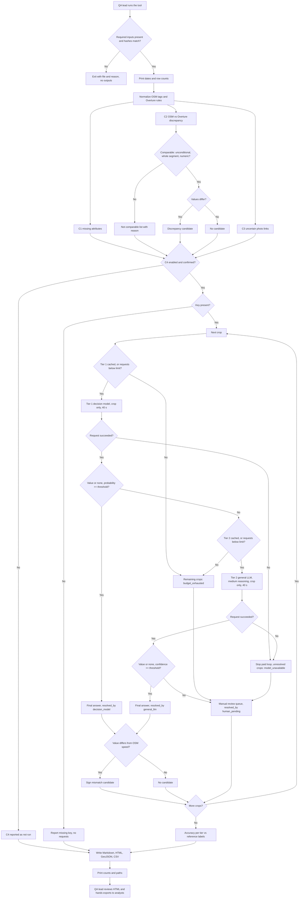

# PRD — Map QA: Road Attribute Review for Kraków

---

## 1. Executive Summary

This is an MVP of a command-line tool that produces a review report and an exportable task list of road-attribute problem candidates for the Kraków area. It combines OpenStreetMap roads, Overture Maps road segments and street-level photographs (Panoramax, Mapillary), and uses AI only to read the value of speed-limit signs. Reading is escalated in three tiers: a decision model, then a general LLM when the decision model is uncertain, then a human manual review queue when both are uncertain. The tool helps a QA team lead see where the map may be wrong and hand concrete, evidence-backed tasks to map analysts. It never decides by itself that the map is wrong.

---

## 2. Problem Statement

Road attributes such as speed limit and surface are often missing, inconsistent between data sources, or outdated. Today a QA lead has no single view that answers "where should my team look first, and why". To build such a view, someone has to:

- query OSM and Overture separately and compare tags by hand,
- find a street photo near a road and work out whether it really shows that road (the camera may be on a parallel road, on a bridge, facing the other way, or have a bad GPS position),
- look at each photo to read a speed-limit sign,
- copy identifiers, coordinates and photo links into a ticket.

This is slow and not repeatable. Two common mistakes follow from it. A difference between sources gets treated as proof of a map error, and an uncertain photo-to-road match gets treated as fact.

---

## 3. Users / Personas

### 3.1 QA team lead (primary)
- Runs the tool on the current data snapshot, or asks an engineer to run it.
- Reads the summary: how many candidates of each check type, how many links are uncertain, and how well each AI tier reads signs compared with the reference labels.
- Opens individual candidates to judge whether the evidence is good enough. Then exports the task list and hands it to analysts.
- Works through the manual review queue: the signs that neither the decision model nor the general LLM could read with enough confidence.
- Expects that every number in the summary can be traced to individual rows, and that uncertainty is visible rather than hidden.

### 3.2 Map QA analyst (secondary)
- Does not run the tool. Receives the exported tasks (GeoJSON/CSV) and opens them in an editor or GIS tool to verify and, where justified, fix the map.
- Expects each task to have stable OSM/Overture identifiers, a location, the type of problem, the values from each source, a photo link with attribution, and the reasons why the task may be a false alarm.

---

## 4. Main Flows

### 4.1 Happy path: generate report and export
1. The QA lead runs the tool with the local data snapshot as input.
2. The system checks that all required input files exist and that their hashes match the snapshot manifest. It prints the snapshot dates and row counts.
3. The system normalizes OSM tags and Overture attributes without discarding any source tag or rule.
4. The system runs check C1 (missing attributes), C2 (OSM vs Overture discrepancy) and C3 (uncertain photo-to-road links).
5. If the user explicitly enabled the model step and confirmed the request budget, the system runs check C4 (speed-limit sign reading). Otherwise C4 is reported as "not run".
6. The system writes a Markdown report, a static HTML report with photo thumbnails, a GeoJSON task export and a CSV task export, all into one output folder for this run.
7. The system prints the output paths and the count of candidates per check. These counts are identical across the Markdown, HTML, GeoJSON and CSV outputs.
8. The QA lead opens the HTML report, reviews the summary and selected candidates, and passes the export files to analysts.

### 4.2 Sign-reading step (C4) with escalation and budget
1. The system selects sign crops from the sign sample. It shows the planned number of decision-model requests, the maximum possible number of general-LLM requests, the confidence threshold and the request limit.
2. The system asks for confirmation before the first paid request. Without confirmation it makes no request.
3. For each crop, the system first looks in the result cache (keyed by image content hash and tier). A cached result is reused and is not counted as a new request.
4. **Tier 1 — decision model:** for an uncached crop, the system sends only the crop image to the decision model. It records the answer, the probability and the request outcome.
5. If the tier-1 answer is a value or `none` with a probability at or above the threshold, the answer is final and has `resolved_by = decision_model`.
6. **Tier 2 — general LLM:** if the tier-1 answer is `unreadable`, or its probability is below the threshold, the system sends the same crop and the same fixed question to a general-purpose multimodal LLM with a medium reasoning level. It receives no map data and no tier-1 answer. It records the answer, the stated confidence and the outcome.
7. If the tier-2 answer is a value or `none` with a confidence at or above the threshold, the answer is final and has `resolved_by = general_llm`.
8. **Tier 3 — human:** if the tier-2 answer is also `unreadable` or below the threshold, the crop is added to the manual review queue with `resolved_by = human_pending`. Both AI answers and their probabilities are kept as hints for the reviewer.
9. For crops with a final AI answer, the system compares the read value with the OSM speed limit of the candidate road and with the Mapillary detection value. If they differ, it creates a candidate. Crops in the manual review queue create no sign mismatch candidate.
10. The system computes reading accuracy against the reference labels per tier and reports the numerator and denominator for each.

### 4.3 Alternative: model unavailable or budget exhausted
1. A request to either AI tier fails (authentication, payment, rate limit, timeout or invalid response), or the request limit is reached.
2. The system stops all further paid requests for this run, for both tiers. It does not retry automatically.
3. Crops that were not resolved get the status `model_unavailable` (failure) or `budget_exhausted` (limit) and are added to the manual review queue with that reason. They do not count as model errors or map errors.
4. The system still writes all outputs for C1–C3 and the C4 results it already has, and prints the reason the paid loop stopped. Secret values are never printed.

### 4.4 Alternative: invalid or incomplete input
1. A required input file is missing, unreadable, or its hash does not match the manifest.
2. The system stops before producing any outputs and names the file and the reason.
3. Optional inputs (photos not downloaded, offline thumbnails only) do not stop the run. The report shows "image not available locally" and keeps the source link.

### 4.5 Alternative: candidate cannot be compared
1. An attribute value is conditional (time or vehicle restrictions), applies to only part of a segment, is a zone code instead of a number, or holds several values.
2. The system does not force a comparison. It lists the row under "not comparable" with the reason and keeps the original values.

---

## 5. User Stories

1. As a QA lead, I want one report with counts per check type and links to each candidate, so that I can decide where my team should look first.
2. As a QA lead, I want to see why a photo-to-road link is uncertain (alternative roads, heading mismatch, missing heading, panorama, service road, edge of the area), so that I do not send analysts on false alarms.
3. As a QA lead, I want the sign-reading accuracy against the reference labels with explicit denominators, so that I know how much to trust the model reading.
4. As a QA lead, I want the run to stop paid requests at the first error or at the configured limit and still produce the rest of the report, so that a model failure does not cost money or block the deterministic checks.
5. As a QA lead, I want a run with missing or modified input files to fail with a clear message, so that I never review a report built from the wrong data.
6. As a map analyst, I want each exported task to carry OSM and Overture identifiers, coordinates, source values, a photo link and the photo author and license, so that I can verify it in my editor without searching for context.
7. As a map analyst, I want conditional or partial rules marked as "not comparable" instead of being reported as conflicts, so that I am not asked to fix values that are actually correct.
8. As a QA lead, I want a second run on the same snapshot to reuse cached model results and produce the same candidates, so that results are repeatable and do not cost twice.
9. As a QA lead, I want an uncertain decision-model reading to be retried by a general LLM before it reaches a person, so that my team only checks signs that AI could not read.
10. As a QA lead, I want a manual review queue of signs that neither AI tier could read confidently, with both AI answers shown as hints, so that a person makes the final call on exactly those cases.

---

## 6. Acceptance Criteria

### Input and snapshot
- **AC-01:** Before any check runs, the system verifies the SHA-256 hash of every required input file listed in the snapshot manifest. On a mismatch or a missing file it exits with a non-zero status, writes no outputs, and prints the file name and the reason.
- **AC-02:** The system never modifies, moves or overwrites any input file. After a run, the hashes of all input files are unchanged.
- **AC-03:** The report header shows the OSM extract date, the Overture release, the snapshot creation date and the row count of each input. The row counts equal those in the manifest (for example 99,768 OSM roads, 85,405 Overture segments and 561 photos for the provided snapshot).

### Normalization
- **AC-04:** For every OSM road, the original complete tag set is preserved and appears unchanged in the export for that road.
- **AC-05:** For every Overture segment, all `speed_limits` and `road_surface` rules are kept, including their conditions and partial-segment ranges. A segment with three rules produces three rule records, not one.
- **AC-06:** A numeric OSM speed value with an `mph` unit is converted to km/h. A value without a unit is read as km/h. The original string is kept next to the normalized value.
- **AC-07:** Zone codes (e.g. `PL:urban`), `none`, `signals`, several values in one tag and unparsable strings are not converted to a number. They get the status `not_numeric` with the original string kept.

### C1 — Missing attributes
- **AC-08:** For each of `maxspeed` (including directional variants), `surface`, `lanes` and `lit`, the report shows the number and share of OSM roads without the attribute, broken down by road class.
- **AC-09:** For Overture, the report shows the number and share of segments without any `speed_limits` rule and without any `road_surface` rule, broken down by class.
- **AC-10:** A road missing an attribute becomes an exported task only when at least one photo is linked to it. Roads without photos are counted in the summary but not exported.

### C2 — OSM vs Overture discrepancy
- **AC-11:** An OSM road and an Overture segment are compared only when the Overture segment references that OSM way in its sources (`osm_source_reference`). Spatial-only matches are listed separately and never produce a discrepancy candidate.
- **AC-12:** A speed discrepancy candidate is created when both sides have an unconditional, whole-segment numeric speed limit for the same direction and the values differ by any amount after normalization to km/h.
- **AC-13:** A surface discrepancy candidate is created when both sides have an unconditional, whole-segment surface value and the values belong to different families (paved vs unpaved). The report documents the value-to-family mapping, and every source value is assigned to `paved`, `unpaved` or `unknown`. `unknown` is never compared.
- **AC-14:** Rules with conditions, partial-segment ranges, direction mismatch or `not_numeric` values go to the "not comparable" list with a reason code, and are not counted as discrepancies.
- **AC-15:** Every discrepancy candidate shows both raw values, both normalized values, the OSM way ID, the Overture segment ID and the OSM extract date and Overture release. The two dates are shown because sources of different ages can legitimately differ.

### C3 — Uncertain photo-to-road links
- **AC-16:** A photo link is "uncertain" when it has at least one of these flags: `ambiguous_candidates`, `camera_against_way_direction`, `panorama_heading_ambiguous`, `poor_heading_alignment`, `missing_heading`, `service_way`, `boundary_crossing`, `overture_spatial_only`, `no_osm_within_25m`. The report shows the count per flag and the count of photos with at least one flag.
- **AC-17:** All distances shown in the report are computed with both layers in EPSG:2180 and shown in metres, rounded to 0.1 m.
- **AC-18:** A heading of `0` is treated as north. An empty heading is treated as missing and is never replaced by `0`.
- **AC-19:** Any C1, C2 or C4 candidate whose photo link is uncertain is labeled "uncertain link" in the report and the export, and lists the flags.

### C4 — Speed-limit sign reading
- **AC-20:** C4 runs only when the user explicitly enables it and confirms the planned number of requests. Without both, the system makes zero AI requests in either tier and C4 is reported as "not run".
- **AC-21:** Both AI tiers receive only the sign crop image and the same fixed question. Neither ever receives map attributes, Mapillary detection values, reference labels, coordinates, road identifiers or the other tier's answer.
- **AC-22:** Each AI answer is one of: a speed value in km/h (round B-33 speed-limit sign), `none` (no B-33 sign, or a zone/end-of-limit sign), or `unreadable`. Each answer carries a probability (tier 1) or stated confidence (tier 2) between 0 and 1. The system records and shows every answer and its probability, including answers that were escalated.
- **AC-22a:** A single confidence threshold is set before the run. It is shown in the CLI confirmation and in the report header, and it cannot change during a run. The default is 0.7.
- **AC-22b:** A tier-1 answer is final (`resolved_by = decision_model`) only when it is a value or `none` and its probability is at or above the threshold. In every other case the crop is escalated to tier 2.
- **AC-22c:** Tier 2 is a general-purpose multimodal LLM run with a medium reasoning level. A tier-2 answer is final (`resolved_by = general_llm`) only when it is a value or `none` and its confidence is at or above the threshold.
- **AC-22d:** A crop with no final AI answer (tier 2 `unreadable`, tier 2 below threshold, `model_unavailable` or `budget_exhausted`) is added to the manual review queue with `resolved_by = human_pending` and a reason code. No crop is both in the manual review queue and resolved by AI.
- **AC-22e:** Every crop in the provided sign sample ends in exactly one of: `decision_model`, `general_llm`, `human_pending`, or `not run`. The counts of these four add up to the number of crops processed.
- **AC-23:** The total number of AI requests per run, across both tiers and including failed ones, never exceeds the configured limit. The default and maximum limit is 25. Cached results do not count toward it. Before confirmation, the CLI shows the worst case: tier-1 requests plus one tier-2 request per tier-1 crop.
- **AC-24:** There are no automatic retries in either tier. After the first failed request in either tier, the system stops all remaining AI requests for the run, and the unresolved crops get `model_unavailable` and go to the manual review queue.
- **AC-25:** Each request times out after 40 seconds. A timeout counts as a failed request.
- **AC-26:** Running the tool again on the same crops returns cached results for both tiers and makes zero new requests.
- **AC-27:** A sign mismatch candidate is created only for a crop with a final AI answer whose numeric value differs from the normalized OSM speed limit of the candidate road. The candidate shows which tier resolved it, the Mapillary detection value and the raw OSM speed tags (including directional and conditional ones).
- **AC-28:** The report shows reading accuracy against the reference sign labels as "correct / evaluated", separately for tier-1 final answers, tier-2 final answers and all AI-final answers combined. It also shows the size of the manual review queue per reason code. Crops in the manual review queue are not counted as correct or wrong. Reference labels are used only for this evaluation and never as model input.
- **AC-28a:** The manual review queue is a separate section of the HTML and Markdown reports and a separate task type (`C4-manual`) in the GeoJSON and CSV exports. Each item shows the crop, the full photo link with attribution, both AI answers with probabilities (when available) and the reason code. It does not show the reference label.
- **AC-29:** The report states that the camera heading is not the direction of travel and that the nearest road does not prove where the sign applies.

### Report and export
- **AC-30:** One run produces a Markdown report, a static HTML report, a GeoJSON export and a CSV export in one run folder. The candidate counts per check are identical across all four.
- **AC-31:** The HTML report opens from the local disk without a server. It uses relative image paths, does not embed images as base64, and escapes all text that comes from source data.
- **AC-32:** Every displayed photo shows its author, license and a link to the source page. The report and exports include the attribution "© OpenStreetMap contributors", the Overture Maps Foundation attribution and the photo license (CC BY-SA 4.0).
- **AC-33:** The GeoJSON export uses WGS84 longitude/latitude coordinates. Each task has: a stable task ID, the check type (C1, C2, C3, C4 or C4-manual), the resolving tier for C4 tasks, the OSM way ID, the Overture segment ID (when available), the photo ID and link, raw and normalized source values, the uncertainty flags and a short problem description.
- **AC-34:** The CSV export has one row per task with the same task IDs and fields as the GeoJSON, plus longitude and latitude columns. It is UTF-8 encoded.
- **AC-35:** Running the tool twice on the same snapshot, with the same cache, produces exports with identical task IDs and content.
- **AC-36:** The report never states that the map is wrong. Each candidate is described as "needs review" with the evidence and the reasons it may be a false alarm.

### General
- **AC-37:** Secrets (for example the model API key) are read only from environment variables. Their values never appear in output files, logs or console output. If the key is missing and C4 is enabled, the system reports that the key is missing, makes no request and still runs C1–C3.
- **AC-38:** Report text shown to the user is in Polish, with correct Polish characters in Markdown, HTML and CSV.

---

## 7. Out of Scope

- **Databricks and live APIs:** the MVP reads only the local snapshot files. Databricks tables, the Mapillary/Panoramax APIs and fetching a newer Overture release are not used.
- **Interactive dashboard:** no map application, filters or server. Only static Markdown and HTML.
- **Storing review decisions:** the tool does not record whether a candidate was confirmed or rejected, and the next run does not use earlier decisions.
- **Editing the map or uploading tasks:** no edits to OSM or Overture, and no automatic upload to MapRoulette, JOSM, Jira or any other tool. Exports are files only.
- **Automatic map-error verdicts:** no candidate is marked as a confirmed error.
- **Other visual attributes:** the model does not read surface, lanes, sidewalks, lighting or junctions from photos. Only the speed-limit sign value is read.
- **Other sign types:** zone signs, end-of-limit signs and non-B-33 signs are answered as `none` and are not interpreted further.
- **Topology checks:** junction connectivity, connectors and road level (bridges, tunnels) are not checked, apart from showing existing flags.
- **Other areas and refresh:** only the provided Kraków snapshot. No new extracts or scheduled runs.
- **Authentication, user accounts, notifications, mobile and multilingual UI.**
- **Model training or fine-tuning.**

---

## 8. Constraints

### Business
- OSM data and Overture transportation data are under ODbL 1.0. Outputs must keep the "© OpenStreetMap contributors" and Overture attributions. Sharing a derived database requires checking ODbL obligations first.
- Photos are CC BY-SA 4.0. Every displayed photo must credit its author and license and link to the source.
- Model use is paid from a shared course budget. No request may be made without explicit confirmation and an assigned budget.
- No company or private data. Only the provided public snapshot.

### Functional
- Area: Kraków and the surroundings, bbox 19.80–20.15 E, 49.95–50.15 N.
- Input sizes in the provided snapshot: 99,768 OSM roads, 85,405 Overture segments, 561 photos with 561 link rows (558 with an OSM candidate), 1,730 Mapillary speed-limit features, 119 sign crops with reference labels.
- Metric distances only in EPSG:2180, after transforming both layers. OSM is EPSG:4326 and Overture is OGC:CRS84, both longitude/latitude.
- Model limit: at most 25 requests per run including failures, 40-second timeout, no automatic retries, cache by image hash.
- The provided photo-to-road links are candidates within 25 m of the camera, not ground truth.
- Output language for users: Polish. Identifiers and file names: English.

### External document / data references

| Document / data | Path | When it is used |
|---|---|---|
| Snapshot manifest (area, dates, hashes, link rules) | `course-materials/exercise-data/map-qa/sources.json` | Input validation (AC-01, AC-03), report header |
| OSM roads | `course-materials/exercise-data/map-qa/osm_roads.parquet` | C1, C2, C4 comparison |
| Overture segments | `course-materials/exercise-data/map-qa/overture_segments.parquet` | C1, C2 |
| Photo manifest | `course-materials/exercise-data/map-qa/photos.csv` | Photo metadata, attribution, links |
| Photo-to-road links | `course-materials/exercise-data/map-qa/photo_road_links.csv` | C3, linking photos to C1/C2 candidates |
| Sign sample (photos, crops, nearest OSM road) | `course-materials/exercise-data/map-qa/signs/` | C4 |
| Reference sign labels | `course-materials/exercise-data/map-qa/signs/labels.csv` | C4 evaluation only |
| Offline thumbnails and attribution | `course-materials/exercise-data/map-qa/offline/` | Report thumbnails when photos are not downloaded |
| Data description and CRS rules | `course-materials/exercise-data/map-qa/README.md` | Reference for normalization and linking rules |

---

## 9. UI Description (wireframe level)

### 9.1 Command line
- One command with options: input snapshot location, output folder, a switch to enable C4, the C4 request limit (default 25, maximum 25) and the confidence threshold (default 0.7).
- **Before the checks:** prints the snapshot dates, the row counts and the validation result.
- **With C4 enabled:** prints the planned number of uncached tier-1 requests, the worst-case number of tier-2 requests, the threshold and the limit, then asks for yes/no confirmation. Anything other than an explicit yes runs without C4.
- **During the run:** one progress line per check.
- **At the end:** prints the counts per check, the C4 request count per tier (used / limit / cached), how many crops each tier resolved, the size of the manual review queue, the reason the paid loop stopped (if it did) and the paths to the four outputs.
- **Errors:** a single message with the file or step and the reason, then a non-zero exit code.

### 9.2 HTML report — summary section
- Header: snapshot dates, Overture release, run time, attribution block.
- A table of counts per check (C1–C4 and the manual review queue) and per reason code, including "not comparable" and "uncertain link".
- A C4 block: run / not run, threshold, requests used per tier / limit, cached, crops resolved by `decision_model`, by `general_llm` and `human_pending`, accuracy as "correct / evaluated" per tier, and the manual review queue size per reason code.
- Each count links to its list section.
- **Empty state:** a check with no candidates shows "0 candidates" and the number of rows that were checked.

### 9.3 HTML report — candidate lists
- One section per check, one row per candidate: task ID, problem type, OSM way ID, Overture segment ID, raw and normalized values from each side, distance in metres, uncertainty flags, photo thumbnail with author/license/source link.
- C4 rows also show the crop, the tier-1 answer and probability, the tier-2 answer and confidence (when escalated), the resolving tier, the Mapillary value and the raw OSM speed tags.
- **Manual review queue:** a separate section after C4. One row per crop: crop, full photo link with attribution, both AI answers with probabilities as hints, and the reason code (`below_threshold`, `unreadable`, `model_unavailable`, `budget_exhausted`). Empty state: "No signs need manual review".
- **Missing image:** "image not available locally" plus the source link.
- **Missing model result:** the status (`model_unavailable`, `budget_exhausted`, `not run`) instead of a value.
- No sorting or filtering controls beyond the browser's own search. Rows are in a fixed, deterministic order.

### 9.4 Markdown report
- The same summary and counts as the HTML report, and the candidate tables without thumbnails (with photo links).

### 9.5 Exports
- GeoJSON and CSV files described in AC-33 and AC-34. They have no visual UI.

---

## 10. User Flow Diagram

---

## 11. Agent / System Behavior Specification

- **Role:** AI reads the value of a round B-33 speed-limit sign from a single crop, in up to two tiers. Code makes every other decision: distances, matching, escalation, comparisons, candidate creation and accuracy.
- **Escalation chain:**
  1. **Decision model (tier 1):** a model specialized in closed-set decisions with calibrated probabilities. It reads every crop first.
  2. **General LLM (tier 2):** a general-purpose multimodal model with a medium reasoning level. It is called only when tier 1 answers `unreadable` or is below the threshold. It answers independently, without seeing the tier-1 answer.
  3. **Human (tier 3):** the manual review queue. It receives a crop only when tier 2 is also uncertain, or when the paid loop stopped. A person decides; the tool does not store that decision in the MVP.
- **Allowed:** answer with a km/h value, `none` or `unreadable`, together with a probability or confidence.
- **Not allowed:** receiving or using map attributes, detection values, reference labels, coordinates, road IDs or the other tier's answer. Deciding whether the map is wrong. Being called beyond the shared request limit, retried automatically, or called without the user's confirmation. Tier 2 overriding a confident tier-1 answer (tier 2 is never called for those).
- **Decision categories and communication:**
  - numeric value (final): shown with its probability and resolving tier. If it differs from OSM, a "needs review" candidate is created.
  - `none` (final): shown as "no B-33 sign"; it creates no candidate by itself.
  - escalated: the tier-1 answer stays visible with the note "escalated to general LLM".
  - `human_pending`: shown in the manual review queue with both AI answers as hints and a reason code.
  - `model_unavailable` / `budget_exhausted` / `not run`: shown as statuses, never as model answers.
- **Uncertainty:** answers below the threshold are never used as final, but they are never hidden either. The probability is always shown next to the answer.
- **Mandatory notices in the report:** the model reading is not ground truth; the camera heading is not the travel direction; the nearest road does not prove the sign applies to it; a difference between sources is not proof of a map error.
- **Off-topic or unexpected model output:** an answer outside the allowed set is recorded as an invalid response. It counts as a failed request, so the paid loop stops (AC-24).
- **Language:** the report is in Polish. The model question and answer format are fixed and are not shown to the end user beyond the answer and the probability.

---

## 12. Further Notes

- **Decision taken: three-tier escalation** (decision model → general LLM → manual review queue) with one confidence threshold for both AI tiers. The model always returns an answer; the threshold only decides whether the answer is final or escalated.
- **Assumption:** the default threshold is 0.7. It is fixed before measurement and can be tuned later on saved answers without new requests. Tier-2 confidence is self-reported and may be less calibrated than tier-1 probabilities; the per-tier accuracy (AC-28) shows whether the shared threshold is reasonable.
- **Decision taken: one shared request limit.** Both tiers share the single 25-request limit per run (AC-23). In the worst case every tier-1 answer escalates, so at most 12 crops can be read in one run (12 + 12 = 24 requests). Larger samples are read over several runs, reusing the cache.
- **Open question:** whether the general LLM must come from a different model family than the decision model, so that the two tiers do not fail on the same images. To be decided in the ADR.
- **Assumption:** the expected speed for zone codes (e.g. `PL:urban`) is not inferred in the MVP; such values are `not_numeric`. A mapping to legal default speeds can be added after a decision.
- **Assumption:** the paved/unpaved mapping for OSM `surface` and Overture `road_surface` values is defined during design and documented in the report (AC-13).
- **Assumption:** C1 exports only roads that have at least one linked photo, so that the task list stays small and has evidence. Unexported counts remain in the summary.
- **Open question:** which OSM speed value to compare with a sign when directional tags exist (`maxspeed:forward` / `maxspeed:backward`) and the camera heading is ambiguous. Default: list as "not comparable" when the direction cannot be determined.
- **Open question:** the exact choice of both AI models and the API is left to the ADR, within the request and cost limits above.
- **Language note:** this PRD is written in English at the user's request. Repository guidance (AGENTS.md) asks for Polish course documents, and user-facing report text stays Polish.
